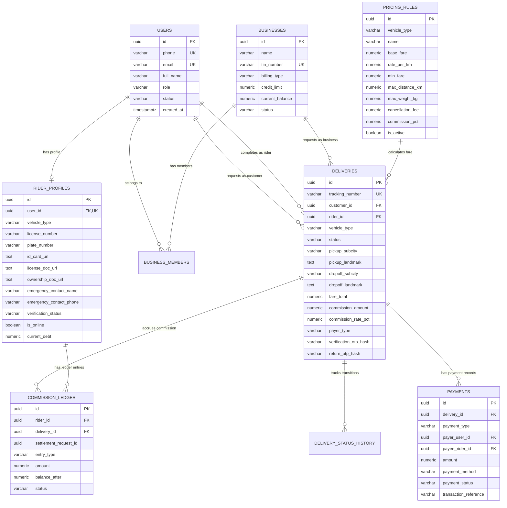

# Ethiopian Motorcycle & Bicycle Delivery Platform
## Database Design Specification (`DATABASE_DESIGN.md`)

---

## 1. Database Architecture & Technology

The primary database is **PostgreSQL on Neon**, accessed through **Drizzle ORM** in a serverless environment via connection pooling (PgBouncer). 

The MVP pilot is **Addis Ababa only**. Development and automated tests target an isolated **Neon development branch** (or separate development database) completely segregated from production. Never point local development or test runs at production.

### Confirmed MVP Financial and Product Decisions
- **Payer Scope**: Delivery fee payer is strictly `sender` or `receiver`. The designated person pays the courier directly.
- **Business Billing Deferred**: Business accounts may create and manage bookings, but centralized corporate credit lines, consolidated postpaid invoicing, and prepaid corporate balances are deferred.
- **Commission Baselines**: Configurable seed test defaults are **15.00% for motorcycles** and **10.00% for bicycles**. These rates and the resulting calculated commission amount are snapshotted onto each delivery upon booking.
- **Delivery vs Payment Decoupling**: Delivery completion (`delivered`) is unlocked exclusively by recipient OTP verification; electronic payment reconciliation (`verified`) is an accounting check that does not gate delivery handover or commission accrual.
- **No Direct DDL / Migration Execution**: No live schema changes or DDL executions are authorized by this documentation specification.

### Key Architectural Standards
1. **Primary Keys**: Universally unique identifiers (`UUIDv7` or `gen_random_uuid()`) for all relational entities to avoid enumeration attacks and simplify distributed data creation.
2. **Monetary Precision**: All monetary values (fares, commissions, debts, settlements) are strictly typed as `NUMERIC(12, 2)`. Floating-point types (`FLOAT`, `REAL`, `DOUBLE PRECISION`) are prohibited.
3. **Geographic Coordinates**: Stored as `NUMERIC(9, 6)` for latitude and longitude, providing accuracy down to ~11 centimeters, which is ideal for pickup/drop-off pins without requiring heavy external GIS extensions.
4. **Time & Auditing**: Every table includes `created_at TIMESTAMPTZ DEFAULT NOW()` and `updated_at TIMESTAMPTZ DEFAULT NOW()`. Timestamps are always stored in UTC.

---

## 2. Entity-Relationship (ER) Diagram



---

## 3. Relational Schema Definitions

### 3.1 `users` Table
Stores user credentials, phone identity, roles, and status.

| Column | Data Type | Constraints | Description |
| :--- | :--- | :--- | :--- |
| `id` | `UUID` | Primary Key, `DEFAULT gen_random_uuid()` | Unique user identifier |
| `phone` | `VARCHAR(20)` | `NOT NULL`, `UNIQUE` | Ethiopian phone number (`+251911234567`) |
| `email` | `VARCHAR(255)` | `UNIQUE`, `NULLABLE` | Optional email identifier |
| `password_hash` | `VARCHAR(255)` | `NULLABLE` | Optional password hash for business/admin staff |
| `full_name` | `VARCHAR(100)` | `NOT NULL` | Legal full name |
| `role` | `VARCHAR(20)` | `NOT NULL` | Enum: `customer`, `rider`, `business_staff`, `admin` |
| `status` | `VARCHAR(20)` | `NOT NULL`, `DEFAULT 'active'` | Enum: `active`, `suspended`, `pending_verification` |
| `created_at` | `TIMESTAMPTZ` | `NOT NULL`, `DEFAULT NOW()` | Account creation timestamp |
| `updated_at` | `TIMESTAMPTZ` | `NOT NULL`, `DEFAULT NOW()` | Last update timestamp |

### 3.2 `businesses` Table
Stores merchant and enterprise accounts (centralized billing deferred for MVP).

| Column | Data Type | Constraints | Description |
| :--- | :--- | :--- | :--- |
| `id` | `UUID` | Primary Key, `DEFAULT gen_random_uuid()` | Unique business identifier |
| `name` | `VARCHAR(150)` | `NOT NULL` | Registered trading name |
| `tin_number` | `VARCHAR(50)` | `NOT NULL`, `UNIQUE` | Ethiopian Tax Identification Number |
| `contact_phone` | `VARCHAR(20)` | `NOT NULL` | Official business phone |
| `contact_email` | `VARCHAR(255)` | `NOT NULL` | Notification email |
| `billing_type` | `VARCHAR(20)` | `NOT NULL`, `DEFAULT 'prepaid'` | Enum: `prepaid`, `postpaid_credit` |
| `credit_limit` | `NUMERIC(12, 2)` | `NOT NULL`, `DEFAULT 0.00` | Approved credit limit in ETB |
| `current_balance`| `NUMERIC(12, 2)` | `NOT NULL`, `DEFAULT 0.00` | Accrued balance in ETB |
| `status` | `VARCHAR(20)` | `NOT NULL`, `DEFAULT 'active'` | Enum: `active`, `suspended`, `closed` |
| `created_at` | `TIMESTAMPTZ` | `NOT NULL`, `DEFAULT NOW()` | Creation timestamp |
| `updated_at` | `TIMESTAMPTZ` | `NOT NULL`, `DEFAULT NOW()` | Last modification timestamp |

### 3.3 `business_members` Table
Associates authorized staff with a business account.

| Column | Data Type | Constraints | Description |
| :--- | :--- | :--- | :--- |
| `id` | `UUID` | Primary Key, `DEFAULT gen_random_uuid()` | Membership identifier |
| `business_id` | `UUID` | `NOT NULL`, `REFERENCES businesses(id) ON DELETE CASCADE` | Associated business |
| `user_id` | `UUID` | `NOT NULL`, `REFERENCES users(id) ON DELETE CASCADE` | Associated user |
| `member_role` | `VARCHAR(20)` | `NOT NULL`, `DEFAULT 'staff'` | Enum: `owner`, `manager`, `staff` |
| `created_at` | `TIMESTAMPTZ` | `NOT NULL`, `DEFAULT NOW()` | Date added |

*Constraint: `UNIQUE(business_id, user_id)`*

### 3.4 `rider_profiles` Table
Stores courier verification, vehicle compliance documents, location, and debt summary.

| Column | Data Type | Constraints | Description |
| :--- | :--- | :--- | :--- |
| `id` | `UUID` | Primary Key, `DEFAULT gen_random_uuid()` | Profile identifier |
| `user_id` | `UUID` | `NOT NULL`, `UNIQUE`, `REFERENCES users(id) ON DELETE CASCADE` | Associated user |
| `vehicle_type` | `VARCHAR(20)` | `NOT NULL` | Enum: `motorcycle`, `bicycle` |
| `license_number`| `VARCHAR(50)` | `NULLABLE` | Driver's license number (motorcycle) |
| `plate_number` | `VARCHAR(30)` | `NULLABLE` | License plate registration (motorcycle) |
| `id_card_url` | `TEXT` | `NOT NULL` | Kebele ID / National ID document image URL |
| `license_doc_url`| `TEXT` | `NULLABLE` | Driver's license document image URL (motorcycle) |
| `ownership_doc_url`| `TEXT` | `NULLABLE` | Vehicle Libre registration booklet image URL (motorcycle) |
| `emergency_contact_name`| `VARCHAR(100)`| `NOT NULL` | Mandatory emergency contact person |
| `emergency_contact_phone`| `VARCHAR(20)`| `NOT NULL` | Mandatory emergency contact phone |
| `verification_status`| `VARCHAR(20)`| `NOT NULL`, `DEFAULT 'pending'` | Enum: `pending`, `approved`, `rejected`, `suspended` |
| `verified_at` | `TIMESTAMPTZ` | `NULLABLE` | Timestamp of admin approval |
| `verified_by_admin_id`| `UUID` | `NULLABLE`, `REFERENCES users(id)` | Reviewing administrator |
| `is_online` | `BOOLEAN` | `NOT NULL`, `DEFAULT false` | Availability flag for job broadcasts |
| `last_known_lat`| `NUMERIC(9, 6)` | `NULLABLE` | Last reported latitude |
| `last_known_lng`| `NUMERIC(9, 6)` | `NULLABLE` | Last reported longitude |
| `last_location_at`| `TIMESTAMPTZ`| `NULLABLE` | Timestamp of last location ping |
| `current_debt` | `NUMERIC(12, 2)`| `NOT NULL`, `DEFAULT 0.00` | Cached debt balance owed to platform (ledger is source of truth) |
| `created_at` | `TIMESTAMPTZ` | `NOT NULL`, `DEFAULT NOW()` | Registration timestamp |
| `updated_at` | `TIMESTAMPTZ` | `NOT NULL`, `DEFAULT NOW()` | Last update timestamp |

### 3.5 `pricing_rules` Table
Stores vehicle pricing parameters configurable by administrators for Addis Ababa.

| Column | Data Type | Constraints | Description |
| :--- | :--- | :--- | :--- |
| `id` | `UUID` | Primary Key, `DEFAULT gen_random_uuid()` | Rule identifier |
| `vehicle_type` | `VARCHAR(20)` | `NOT NULL` | Enum: `motorcycle`, `bicycle` |
| `name` | `VARCHAR(100)` | `NOT NULL` | e.g., "Addis Standard Motorcycle 2026" |
| `base_fare` | `NUMERIC(12, 2)` | `NOT NULL` | Starting base charge (ETB) |
| `rate_per_km` | `NUMERIC(12, 2)` | `NOT NULL` | Distance rate per kilometer (ETB) |
| `min_fare` | `NUMERIC(12, 2)` | `NOT NULL` | Absolute minimum delivery charge (ETB) |
| `max_distance_km`| `NUMERIC(6, 2)` | `NOT NULL` | Max permitted trip distance (km) |
| `max_weight_kg` | `NUMERIC(6, 2)` | `NOT NULL` | Max package weight (kg) |
| `cancellation_fee`| `NUMERIC(12, 2)` | `NOT NULL` | Fee charged if cancelled post-arrival (ETB) |
| `commission_pct` | `NUMERIC(5, 2)` | `NOT NULL` | Platform commission rate (e.g., 15.00% motorcycle, 10.00% bicycle) |
| `is_active` | `BOOLEAN` | `NOT NULL`, `DEFAULT true` | Only one active rule per vehicle type |
| `created_at` | `TIMESTAMPTZ` | `NOT NULL`, `DEFAULT NOW()` | Rule creation timestamp |
| `updated_at` | `TIMESTAMPTZ` | `NOT NULL`, `DEFAULT NOW()` | Last update timestamp |

### 3.6 `deliveries` Table
Core transactional entity representing point-to-point delivery orders.

| Column | Data Type | Constraints | Description |
| :--- | :--- | :--- | :--- |
| `id` | `UUID` | Primary Key, `DEFAULT gen_random_uuid()` | Delivery identifier |
| `tracking_number`| `VARCHAR(25)` | `NOT NULL`, `UNIQUE` | Human-friendly code (e.g., `ET-DEL-91823`) |
| `customer_id` | `UUID` | `NOT NULL`, `REFERENCES users(id)` | Order creator |
| `business_id` | `UUID` | `NULLABLE`, `REFERENCES businesses(id)` | Associated business account (if applicable) |
| `rider_id` | `UUID` | `NULLABLE`, `REFERENCES users(id)` | Assigned courier |
| `vehicle_type` | `VARCHAR(20)` | `NOT NULL` | Enum: `motorcycle`, `bicycle` |
| `status` | `VARCHAR(20)` | `NOT NULL`, `DEFAULT 'requested'` | Enum: `requested`, `assigned`, `arrived_pickup`, `picked_up`, `arrived_dropoff`, `delivered`, `failed`, `returned`, `cancelled` |
| `pickup_address` | `TEXT` | `NOT NULL` | Descriptive pickup street/area |
| `pickup_landmark`| `TEXT` | `NOT NULL` | Known landmark for pickup |
| `pickup_subcity` | `VARCHAR(50)` | `NOT NULL` | Bole, Kirkos, Yeka, etc. |
| `pickup_woreda` | `VARCHAR(20)` | `NULLABLE` | Local district number |
| `pickup_lat` | `NUMERIC(9, 6)` | `NULLABLE` | Pickup latitude coordinate |
| `pickup_lng` | `NUMERIC(9, 6)` | `NULLABLE` | Pickup longitude coordinate |
| `pickup_contact_name`| `VARCHAR(100)`| `NOT NULL` | Sender contact person |
| `pickup_contact_phone`| `VARCHAR(20)`| `NOT NULL` | Sender contact phone |
| `dropoff_address`| `TEXT` | `NOT NULL` | Descriptive drop-off street/area |
| `dropoff_landmark`| `TEXT` | `NOT NULL` | Known landmark for drop-off |
| `dropoff_subcity`| `VARCHAR(50)` | `NOT NULL` | Destination sub-city |
| `dropoff_woreda` | `VARCHAR(20)` | `NULLABLE` | Destination woreda |
| `dropoff_lat` | `NUMERIC(9, 6)` | `NULLABLE` | Drop-off latitude coordinate |
| `dropoff_lng` | `NUMERIC(9, 6)` | `NULLABLE` | Drop-off longitude coordinate |
| `dropoff_contact_name`| `VARCHAR(100)`| `NOT NULL` | Recipient contact person |
| `dropoff_contact_phone`| `VARCHAR(20)`| `NOT NULL` | Recipient contact phone |
| `package_description`| `TEXT` | `NOT NULL` | Parcel contents description |
| `package_category`| `VARCHAR(50)` | `NOT NULL` | Document, Electronics, Clothes, etc. |
| `package_weight_kg`| `NUMERIC(6, 2)`| `NOT NULL` | Parcel weight |
| `is_fragile` | `BOOLEAN` | `NOT NULL`, `DEFAULT false` | Fragile handling flag |
| `special_instructions`| `TEXT` | `NULLABLE` | Courier handling notes |
| `estimated_distance_km`| `NUMERIC(6, 2)`| `NOT NULL` | Billed trip distance |
| `fare_base` | `NUMERIC(12, 2)`| `NOT NULL` | Base fare component (ETB) |
| `fare_distance` | `NUMERIC(12, 2)`| `NOT NULL` | Distance fare component (ETB) |
| `fare_surcharges`| `NUMERIC(12, 2)`| `NOT NULL`, `DEFAULT 0.00` | Surcharges (ETB) |
| `fare_total` | `NUMERIC(12, 2)`| `NOT NULL` | Final total delivery fee (ETB) |
| `commission_amount`| `NUMERIC(12, 2)`| `NOT NULL` | Commission snapshot for this delivery (ETB) |
| `commission_rate_pct`| `NUMERIC(5, 2)`| `NOT NULL` | Commission rate snapshot (15.00 or 10.00) |
| `payer_type` | `VARCHAR(20)` | `NOT NULL` | Enum: `sender`, `receiver` (business billing deferred) |
| `verification_otp_hash`| `VARCHAR(255)`| `NULLABLE` | Peppered HMAC-SHA256 verifier for recipient handover; generated at picked_up |
| `verification_otp_salt`| `VARCHAR(64)` | `NULLABLE` | Unique salt for recipient OTP; generated at picked_up |
| `verification_otp_expires_at`| `TIMESTAMPTZ`| `NULLABLE` | Handover OTP expiry timestamp; set at picked_up (60-minute window) |
| `verification_otp_used_at`| `TIMESTAMPTZ`| `NULLABLE` | Handover OTP usage timestamp; set at delivered |
| `verification_attempts`| `INT` | `NOT NULL`, `DEFAULT 0` | Failed handover OTP counter (max 5) |
| `verification_locked`| `BOOLEAN` | `NOT NULL`, `DEFAULT false` | Handover lockout flag |
| `return_otp_hash`| `VARCHAR(255)`| `NULLABLE` | Peppered HMAC-SHA256 verifier for sender return; generated at failed |
| `return_otp_salt`| `VARCHAR(64)` | `NULLABLE` | Unique salt for return OTP; generated at failed |
| `return_otp_expires_at`| `TIMESTAMPTZ`| `NULLABLE` | Return OTP expiry timestamp; set at failed (60-minute window) |
| `return_otp_used_at`| `TIMESTAMPTZ`| `NULLABLE` | Return OTP usage timestamp; set at returned |
| `return_otp_attempts`| `INT` | `NOT NULL`, `DEFAULT 0` | Failed return OTP counter (max 5) |
| `return_otp_locked`| `BOOLEAN` | `NOT NULL`, `DEFAULT false` | Return lockout flag |
| `cancelled_by_user_id`| `UUID` | `NULLABLE`, `REFERENCES users(id)` | User who triggered cancellation |
| `cancellation_reason`| `TEXT` | `NULLABLE` | Mandatory reason note on cancel |
| `cancellation_fee`| `NUMERIC(12, 2)`| `NOT NULL`, `DEFAULT 0.00` | Fee billed if cancelled post-arrival |
| `requested_at` | `TIMESTAMPTZ` | `NOT NULL`, `DEFAULT NOW()` | Broadcast timestamp |
| `assigned_at` | `TIMESTAMPTZ` | `NULLABLE` | Assignment timestamp |
| `arrived_pickup_at`| `TIMESTAMPTZ`| `NULLABLE` | Pickup arrival timestamp |
| `picked_up_at` | `TIMESTAMPTZ` | `NULLABLE` | Package collection timestamp |
| `arrived_dropoff_at`| `TIMESTAMPTZ`| `NULLABLE` | Destination arrival timestamp |
| `delivered_at` | `TIMESTAMPTZ` | `NULLABLE` | Delivery completion timestamp |
| `cancelled_at` | `TIMESTAMPTZ` | `NULLABLE` | Cancellation timestamp |
| `created_at` | `TIMESTAMPTZ` | `NOT NULL`, `DEFAULT NOW()` | Creation timestamp |
| `updated_at` | `TIMESTAMPTZ` | `NOT NULL`, `DEFAULT NOW()` | Modification timestamp |

> [!NOTE]
> Dedicated timestamps `failed_at` and `returned_at` are an optional schema choice deferred to Stage 2. All status transitions are fully recorded with timestamps, actor IDs, operational notes, and GPS coordinates in `delivery_status_history`.

### 3.7 `delivery_status_history` Table
Immutable chronological audit log of all delivery lifecycle state transitions.

| Column | Data Type | Constraints | Description |
| :--- | :--- | :--- | :--- |
| `id` | `UUID` | Primary Key, `DEFAULT gen_random_uuid()` | History record identifier |
| `delivery_id` | `UUID` | `NOT NULL`, `REFERENCES deliveries(id) ON DELETE CASCADE` | Associated delivery |
| `from_status` | `VARCHAR(20)` | `NULLABLE` | Previous state |
| `to_status` | `VARCHAR(20)` | `NOT NULL` | New state |
| `changed_by_user_id`| `UUID` | `NOT NULL`, `REFERENCES users(id)` | Actor triggering transition (courier, customer, or admin) |
| `notes` | `TEXT` | `NULLABLE` | Reason, cancellation notes, failure reasons, or override details |
| `lat` | `NUMERIC(9, 6)` | `NULLABLE` | Latitude at transition |
| `lng` | `NUMERIC(9, 6)` | `NULLABLE` | Longitude at transition |
| `created_at` | `TIMESTAMPTZ` | `NOT NULL`, `DEFAULT NOW()` | Timestamp of state change |

> [!IMPORTANT]
> **Audit Storage & Telemetry Persistence**:
> All lifecycle state transitions (including return confirmations, cancellations, and administrative overrides) persist their audit trail strictly within the fields specified above:
> - **Actor**: `changed_by_user_id` (UUID of courier, sender, or admin).
> - **Timestamp**: `created_at` (`TIMESTAMPTZ DEFAULT NOW()`).
> - **Reason / Justification**: `notes` (`TEXT`, mandatory for cancellations, failure reports, and administrative return overrides).
> - **Location**: `lat` and `lng` (geographic coordinates captured at time of transition).
> 
> *Client IP addresses and User-Agent strings are NOT stored as dedicated columns in `delivery_status_history`.* Any operational request metadata captured by the API gateway is recorded in server request logs or optionally embedded within the unstructured `notes` text field, matching the documented schema without claiming non-existent columns.

### 3.8 `payments` Table
Records direct payer-to-courier delivery fee, cancellation fee, and return fare collections. Multiple records per delivery are permitted for retries, corrections, partial attempts, or disputes. Application logic and database-level partial unique indexes prevent duplicate collections.

| Column | Data Type | Constraints | Description |
| :--- | :--- | :--- | :--- |
| `id` | `UUID` | Primary Key, `DEFAULT gen_random_uuid()` | Payment record identifier |
| `delivery_id` | `UUID` | `NOT NULL`, `REFERENCES deliveries(id)` | Associated delivery (non-unique to allow multiple attempts/types) |
| `payment_type` | `VARCHAR(30)` | `NOT NULL`, `DEFAULT 'delivery_fare'` | Enum: `delivery_fare`, `cancellation_fee`, `return_fare` |
| `payer_user_id` | `UUID` | `NULLABLE`, `REFERENCES users(id)` | Payer account (NULL for unregistered recipients/payers) |
| `payee_rider_id`| `UUID` | `NOT NULL`, `REFERENCES users(id)` | Courier receiving payment |
| `amount` | `NUMERIC(12, 2)`| `NOT NULL` | Collected fee in ETB |
| `payment_method`| `VARCHAR(20)` | `NOT NULL` | Enum: `cash`, `telebirr`, `cbe_birr` |
| `payment_status`| `VARCHAR(30)` | `NOT NULL` | Enum: `pending`, `collected_cash_rider_confirmed`, `collected_unverified`, `verified`, `refused_uncollected`, `disputed`, `failed`, `reversed` |
| `transaction_reference`| `VARCHAR(100)`| `NULLABLE` | Telebirr / CBE transaction SMS reference code |
| `proof_image_url`| `TEXT` | `NULLABLE` | Screenshot of SMS receipt |
| `verified_by_admin_id`| `UUID` | `NULLABLE`, `REFERENCES users(id)` | Reviewing administrator |
| `verified_at` | `TIMESTAMPTZ` | `NULLABLE` | Statement verification timestamp |
| `notes` | `TEXT` | `NULLABLE` | Audit notes or dispute details |
| `created_at` | `TIMESTAMPTZ` | `NOT NULL`, `DEFAULT NOW()` | Record creation timestamp |
| `updated_at` | `TIMESTAMPTZ` | `NOT NULL`, `DEFAULT NOW()` | Record update timestamp |

> [!NOTE]
> **Payment Types & Segregated Accounting**:
> - `payment_type = 'delivery_fare'`: Ordinary fare for completed trip. Subject to standard platform commission upon `delivered`. Guarded by `idx_payments_single_successful_delivery_fare`.
> - `payment_type = 'cancellation_fee'`: Post-arrival cancellation fee (25 ETB bicycle / 40 ETB motorcycle) owed by sender after courier arrives at pickup (`arrived_pickup`). **100% of this fee belongs to the courier with 0% platform commission** (never accrues commission debt). Guarded by `idx_payments_single_cancellation_fee`.
> - `payment_type = 'return_fare'`: Original delivery fare due from sender when delivery ends in `failed` $\rightarrow$ `returned`. Zero platform commission is debited while in dispute. If unpaid, recorded as `refused_uncollected` or `disputed` without violating payment uniqueness rules (since partial unique indexes cover only successful statuses: `collected_cash_rider_confirmed`, `collected_unverified`, `verified`). Guarded by `idx_payments_single_return_fare`.
> - **Uniqueness Isolation**: Storing `payment_type` ensures cancellation fees and return fares never overwrite, confuse, or violate uniqueness constraints on ordinary delivery fees.

### 3.9 `commission_ledger` Table
Append-only source of truth tracking platform commission owed by couriers and manual settlements.

| Column | Data Type | Constraints | Description |
| :--- | :--- | :--- | :--- |
| `id` | `UUID` | Primary Key, `DEFAULT gen_random_uuid()` | Ledger record identifier |
| `rider_id` | `UUID` | `NOT NULL`, `REFERENCES users(id)` | Courier account |
| `delivery_id` | `UUID` | `NULLABLE`, `REFERENCES deliveries(id)` | Associated delivery (if commission accrual) |
| `settlement_request_id`| `UUID`| `NULLABLE` | Associated settlement request (if payment) |
| `entry_type` | `VARCHAR(30)` | `NOT NULL` | Enum: `commission_accrual`, `settlement_payment`, `adjustment`, `penalty` |
| `amount` | `NUMERIC(12, 2)`| `NOT NULL` | Amount in ETB (positive = debt increased, negative = debt paid off) |
| `balance_after` | `NUMERIC(12, 2)`| `NOT NULL` | Snapshot of courier's total debt balance after this entry |
| `status` | `VARCHAR(20)` | `NOT NULL`, `DEFAULT 'accrued'` | Enum: `accrued`, `settled`, `voided` |
| `reference_number`| `VARCHAR(100)`| `NULLABLE` | Bank / Telebirr settlement reference |
| `settled_by_admin_id`| `UUID` | `NULLABLE`, `REFERENCES users(id)` | Approving administrator |
| `notes` | `TEXT` | `NULLABLE` | Settlement details or reason for adjustment |
| `created_at` | `TIMESTAMPTZ` | `NOT NULL`, `DEFAULT NOW()` | Ledger entry timestamp |

---

## 4. Concurrency & Integrity Control

### 4.1 Atomic Job Claiming & Concurrency Guard
Prevents duplicate assignments and enforces that a courier may only hold **one active delivery** across all non-terminal states (`assigned`, `arrived_pickup`, `picked_up`, `arrived_dropoff`, and `failed`). 

#### 4.1.1 Formal Concurrency Analysis & Safety Proof
1. **Multi-Path Lock Uniformity**:
   Every code path that assigns a delivery to a courier:
   - **Path A: Courier Self-Claim from Job Board** (`claimDeliveryAction`)
   - **Path B: Administrator Direct Assignment** (`adminAssignCourierAction`)
   - **Path C: Administrator Reassignment / Dispatch Override** (`adminReassignCourierAction`)
   **MUST** execute the identical pessimistic row lock on `rider_profiles` before checking or updating delivery records.
2. **Mutual Exclusion Proof**:
   Because every registered courier has exactly one row in `rider_profiles`, `SELECT ... FROM rider_profiles WHERE user_id = :target_rider_id FOR UPDATE` acquires an exclusive row-level lock. If two operations for the same courier race concurrently (e.g., two concurrent self-claims, or a self-claim racing with an administrator dispatch), the second transaction blocks at line 1 until the first commits or rolls back. When unblocked, the second transaction reads the committed state and finds either:
   - The courier now has 1 active delivery (aborting with `409 Conflict`), or
   - The courier's debt ceiling is exceeded (aborting with `403 Forbidden`).
3. **Canonical Active Status Invariant**:
   The active statuses checked in Step 4 and indexed in `idx_single_active_delivery_per_rider`:
   `WHERE status IN ('assigned', 'arrived_pickup', 'picked_up', 'arrived_dropoff', 'failed')`
   exactly match the platform's state machine. Terminal statuses (`delivered`, `returned`, `cancelled`) and unassigned status (`requested`) are excluded. `failed` is explicitly included because the courier retains custody of the physical parcel until returned to the sender.
4. **Database-Level Defense-in-Depth**:
   Even if an application server bug bypassed the `rider_profiles` row lock, PostgreSQL's partial unique index `idx_single_active_delivery_per_rider` guarantees at the storage engine level that no two rows can have the same `rider_id` with an active status. Any concurrent insert or update violating this invariant is aborted immediately by PostgreSQL with error code `23505` (`unique_violation`).

#### 4.1.2 SQL Specification: Courier Self-Claim (`Path A`)

```sql
BEGIN;

-- 1. Courier-Level Lock: Serialize all assignment operations for this specific courier
-- Because every registered courier has exactly 1 row in rider_profiles, FOR UPDATE always acquires a lock
SELECT user_id, verification_status, current_debt 
FROM rider_profiles 
WHERE user_id = :claiming_rider_id 
FOR UPDATE;

-- 2. Verify courier vetting status
-- If verification_status != 'approved': ROLLBACK and return 403 Forbidden: 'Courier not approved'.

-- 3. Verify courier debt ceiling: verified debt must be strictly under 500.00 ETB
-- If current_debt >= 500.00 ETB: ROLLBACK and return 403 Forbidden: 'Debt ceiling reached (>= 500 ETB)'.

-- 4. Verify courier currently holds ZERO active deliveries
SELECT id FROM deliveries 
WHERE rider_id = :claiming_rider_id 
  AND status IN ('assigned', 'arrived_pickup', 'picked_up', 'arrived_dropoff', 'failed')
LIMIT 1;
-- If any row exists: ROLLBACK and return 409 Conflict: 'Courier already has an active delivery'.

-- 5. Lock and atomically claim the target delivery
UPDATE deliveries
SET status = 'assigned',
    rider_id = :claiming_rider_id,
    assigned_at = NOW(),
    updated_at = NOW()
WHERE id = :delivery_id 
  AND status = 'requested' 
  AND rider_id IS NULL
RETURNING id;
-- If 0 rows updated: ROLLBACK and return 409 Conflict: 'Job already claimed or unavailable'.

-- 6. Record audit history
INSERT INTO delivery_status_history (
    delivery_id, from_status, to_status, changed_by_user_id, notes
) VALUES (
    :delivery_id, 'requested', 'assigned', :claiming_rider_id, 'Job claimed by courier'
);

COMMIT;
```

#### 4.1.3 SQL Specification: Administrator Manual Assignment (`Path B / C`)

```sql
BEGIN;

-- 1. Courier-Level Lock: Acquire exclusive lock on target courier
SELECT user_id, verification_status, current_debt 
FROM rider_profiles 
WHERE user_id = :target_rider_id 
FOR UPDATE;

-- 2. Verify target courier is approved and under debt ceiling (< 500.00 ETB)
-- If not eligible: ROLLBACK and return 400 Bad Request with failure reason.

-- 3. Verify target courier currently holds ZERO active deliveries
SELECT id FROM deliveries 
WHERE rider_id = :target_rider_id 
  AND status IN ('assigned', 'arrived_pickup', 'picked_up', 'arrived_dropoff', 'failed')
LIMIT 1;
-- If any row exists: ROLLBACK and return 409 Conflict: 'Target courier already holds an active delivery'.

-- 4. Atomically assign or reassign target delivery
UPDATE deliveries
SET status = 'assigned',
    rider_id = :target_rider_id,
    assigned_at = NOW(),
    updated_at = NOW()
WHERE id = :delivery_id 
  AND status IN ('requested', 'assigned')
RETURNING id, status AS previous_status;
-- If 0 rows updated: ROLLBACK and return 409 Conflict: 'Delivery cannot be assigned in current status'.

-- 5. Record audit history with admin actor ID
INSERT INTO delivery_status_history (
    delivery_id, from_status, to_status, changed_by_user_id, notes
) VALUES (
    :delivery_id, :previous_status, 'assigned', :admin_user_id, :admin_assignment_reason
);

COMMIT;
```

### 4.2 Handover Verification & Atomic Commission Accrual
Ensures that the commission ledger debit occurs **only when the `arrived_dropoff` $\rightarrow$ `delivered` transition succeeds**, the recipient OTP is verified, and any required receiver fare collection has been recorded.

#### 4.2.1 Transactional Workflow & Execution Protocol
To avoid ambiguous driver return values from multi-statement CTEs and guarantee deterministic error reporting, the delivery completion procedure executes inside an isolated transaction (`BEGIN ... COMMIT`) following a deterministic two-phase inspection and execution pattern:

```sql
BEGIN;

-- Phase 1: Authoritative Inspection Under Exclusive Row Locks
-- 1. Acquire exclusive lock on courier profile to serialize financial mutations
SELECT user_id, current_debt 
FROM rider_profiles 
WHERE user_id = :rider_id 
FOR UPDATE;

-- 2. Acquire exclusive lock on target delivery row to inspect authoritative state
SELECT id, status, rider_id, payer_type, commission_amount,
       verification_otp_hash, verification_otp_expires_at, 
       verification_otp_used_at, verification_attempts, verification_locked
FROM deliveries 
WHERE id = :delivery_id 
FOR UPDATE;
```

#### 4.2.2 Server-Side Guard Logic & Deterministic Branching
The application backend inspects the locked row and deterministically branches:

1. **Idempotency Check**:
   - If `status = 'delivered'`:
   - Action: `COMMIT;` (or `ROLLBACK;` as no state mutated).
   - Return: HTTP `200 OK: Delivery already completed (idempotent duplicate request)`.

2. **Delivery State & Assignment Guard**:
   - If `status != 'arrived_dropoff'` OR `rider_id != :rider_id`:
   - Action: `ROLLBACK;`.
   - Return: HTTP `409 Conflict: Delivery cannot be delivered from status '${status}'`.

3. **Lockout Guard**:
   - If `verification_locked = true` OR `verification_attempts >= 5`:
   - Action: `ROLLBACK;`.
   - Return: HTTP `403 Forbidden: Verification locked due to excessive failed attempts`.

4. **Server-Side Receiver Payment Prerequisite**:
   - If `payer_type = 'receiver'`:
     ```sql
     SELECT id FROM payments 
     WHERE delivery_id = :delivery_id 
       AND payment_type = 'delivery_fare' 
       AND payment_status IN ('collected_cash_rider_confirmed', 'collected_unverified', 'verified')
     LIMIT 1;
     ```
   - If 0 rows returned:
   - Action: `ROLLBACK;`.
   - Return: HTTP `400 Bad Request: Payment collection must be recorded before completing delivery handover`.
   - *(Note: `verification_attempts` is NOT incremented; this is a payment prerequisite failure, not an invalid OTP entry).*

5. **Cryptographic OTP Validation**:
   - Compute candidate HMAC: $\text{HMAC-SHA256}(\text{ServerPepper}, \text{delivery\_id} + \text{salt} + \text{candidate\_otp})$.
   - If `candidate_hmac != verification_otp_hash` OR `verification_otp_expires_at <= NOW()` OR `verification_otp_used_at IS NOT NULL`:
     ```sql
     UPDATE deliveries 
     SET verification_attempts = verification_attempts + 1,
         verification_locked = (verification_attempts + 1 >= 5),
         updated_at = NOW()
     WHERE id = :delivery_id;
     COMMIT; -- Persist failed attempt counter
     ```
   - Return: HTTP `400 Bad Request: Invalid or expired OTP. (Attempts remaining: ${5 - attempts})`.

6. **Phase 2: Atomic State Transition & Financial Accrual (All Guards Passed)**:
   ```sql
   -- a. Advance delivery status to delivered
   UPDATE deliveries
   SET status = 'delivered',
       delivered_at = NOW(),
       verification_otp_used_at = NOW(),
       updated_at = NOW()
   WHERE id = :delivery_id;

   -- b. Append commission accrual to commission_ledger
   INSERT INTO commission_ledger (
       rider_id, delivery_id, entry_type, amount, balance_after, status, notes
   )
   VALUES (
       :rider_id, 
       :delivery_id, 
       'commission_accrual', 
       :commission_amount,
       (SELECT COALESCE(balance_after, 0.00) 
        FROM commission_ledger 
        WHERE rider_id = :rider_id AND status IN ('accrued', 'settled')
        ORDER BY created_at DESC, id DESC LIMIT 1) + :commission_amount,
       'accrued',
       'Platform commission on delivery completion'
   )
   ON CONFLICT (delivery_id) WHERE entry_type = 'commission_accrual' DO NOTHING
   RETURNING id, balance_after;

   -- c. Atomically synchronize cached current_debt on rider_profiles
   UPDATE rider_profiles
   SET current_debt = (
       SELECT balance_after 
       FROM commission_ledger 
       WHERE rider_id = :rider_id AND status IN ('accrued', 'settled')
       ORDER BY created_at DESC, id DESC LIMIT 1
   ),
   updated_at = NOW()
   WHERE user_id = :rider_id;

   -- d. Record status transition audit
   INSERT INTO delivery_status_history (
       delivery_id, from_status, to_status, changed_by_user_id, notes
   ) VALUES (
       :delivery_id, 'arrived_dropoff', 'delivered', :rider_id, 'Recipient OTP verified; physical handover complete'
   );

   COMMIT;
   ```
   - Return: HTTP `200 OK: { success: true, deliveryId: :delivery_id, balanceAfter: :new_balance }`.

---

### 4.3 Financial Invariant: Commission Ledger as Source of Truth & Profile Debt Synchronization

#### 4.3.1 Architectural Roles & Invariant Definition
- **Immutable Ledger as Sole Source of Truth**: `commission_ledger` is the append-only single source of truth for all courier financial accounting, platform commissions, and settlements. Rows are never mutated or deleted.
- **Materialized Profile Debt Cache**: `rider_profiles.current_debt` is an **explicitly denormalized, materialized balance cache** stored directly on the courier's profile row.
- **Rationale**: Querying `rider_profiles.current_debt` enables $O(1)$ indexed evaluations during Job Board filtering (`current_debt < 500.00 ETB`) and atomic job claims, eliminating expensive running window aggregations or lateral joins across hundreds of thousands of historical ledger entries on every dispatch poll.
- **The Accounting Invariant**:
  Outside of an open serializing transaction, for every courier $R$:
  $$\text{rider\_profiles.current\_debt} \equiv \text{latest balance\_after in } \texttt{commission\_ledger} \text{ where status } \in (\text{'accrued'}, \text{'settled'})$$

#### 4.3.2 Ledger Entry Lifecycle & Balance Mutations
| Entry Type | Trigger Event | Status | Modifies `balance_after`? | Effect on `rider_profiles.current_debt` |
| :--- | :--- | :--- | :--- | :--- |
| `commission_accrual` | Handover completion (`arrived_dropoff` $\rightarrow$ `delivered`) | `'accrued'` | **YES (immediate)** | Increases debt ($+\text{amount}$) |
| `settlement_payment` (Courier submission) | Courier submits Telebirr/CBE ref in portal | `'pending_verification'` | **NO** (`balance_after = NULL`) | **Zero effect** (debt unchanged; job claiming remains blocked if $\ge 500$ ETB) |
| `settlement_payment` (Admin approval) | Admin inspects bank statement and approves settlement | `'settled'` | **YES (upon approval)** | Reduces debt ($-\text{amount}$) |
| `settlement_payment` (Admin rejection) | Admin rejects invalid/unmatched bank reference | `'voided'` | **NO** | Zero effect |
| `adjustment` | Admin manual dispute resolution or correction | `'settled'` | **YES (upon approval)** | Adjusts debt ($+\text{amount}$ or $-\text{amount}$) |

#### 4.3.3 SQL Specification: Administrator Settlement Approval

```sql
BEGIN;

-- 1. Acquire exclusive lock on target courier profile to serialize balance mutations
SELECT user_id, current_debt 
FROM rider_profiles 
WHERE user_id = :rider_id 
FOR UPDATE;

-- 2. Verify settlement request is valid, pending, and uncredited (backed by idx_unique_settlement_ledger_credit)

-- 3. Insert approved settlement credit into commission_ledger
INSERT INTO commission_ledger (
    rider_id, 
    settlement_request_id,
    entry_type, 
    amount, 
    balance_after, 
    status, 
    reference_number,
    settled_by_admin_id,
    notes
)
VALUES (
    :rider_id, 
    :settlement_request_id,
    'settlement_payment', 
    -:approved_settlement_amount, -- Negative value credits/reduces debt
    (SELECT COALESCE(balance_after, 0.00) 
     FROM commission_ledger 
     WHERE rider_id = :rider_id AND status IN ('accrued', 'settled')
     ORDER BY created_at DESC, id DESC LIMIT 1) - :approved_settlement_amount,
    'settled',
    :bank_transaction_reference,
    :admin_user_id,
    :admin_approval_notes
)
ON CONFLICT (settlement_request_id) WHERE entry_type = 'settlement_payment' DO NOTHING
RETURNING id, balance_after;

-- 4. Atomically synchronize rider_profiles.current_debt cache
UPDATE rider_profiles
SET current_debt = (
    SELECT balance_after 
    FROM commission_ledger 
    WHERE rider_id = :rider_id AND status IN ('accrued', 'settled')
    ORDER BY created_at DESC, id DESC LIMIT 1
),
updated_at = NOW()
WHERE user_id = :rider_id;

COMMIT;
```

#### 4.3.4 Drift Detection & Automated Reconciliation
To guarantee absolute data integrity, a background reconciliation job runs periodically to audit cache consistency:

```sql
-- Scheduled Drift Audit & Reconciliation Query
SELECT 
    rp.user_id,
    rp.current_debt AS cached_debt,
    COALESCE(cl.latest_balance, 0.00) AS ledger_debt,
    (rp.current_debt - COALESCE(cl.latest_balance, 0.00)) AS discrepancy
FROM rider_profiles rp
LEFT JOIN LATERAL (
    SELECT balance_after AS latest_balance
    FROM commission_ledger
    WHERE rider_id = rp.user_id AND status IN ('accrued', 'settled')
    ORDER BY created_at DESC, id DESC
    LIMIT 1
) cl ON true
WHERE rp.current_debt != COALESCE(cl.latest_balance, 0.00);
```

If any discrepancy is detected, an alert is triggered, and `rp.current_debt` is automatically resynchronized to `cl.latest_balance`, ensuring that `commission_ledger` remains the uncompromised source of truth.

---

## 5. Performance Indexes & Database-Level Constraints

```sql
-- Fast lookup of available deliveries on the Job Board
CREATE INDEX idx_deliveries_job_board 
ON deliveries (vehicle_type, status, created_at DESC) 
WHERE status = 'requested';

-- Fast lookup of active deliveries per rider
CREATE INDEX idx_deliveries_active_rider 
ON deliveries (rider_id, status) 
WHERE rider_id IS NOT NULL;

-- Unique tracking numbers
CREATE UNIQUE INDEX idx_deliveries_tracking_number 
ON deliveries (tracking_number);

-- Database-Level Concurrency Guard: Enforce exactly zero or one active delivery per courier
CREATE UNIQUE INDEX idx_single_active_delivery_per_rider 
ON deliveries (rider_id) 
WHERE status IN ('assigned', 'arrived_pickup', 'picked_up', 'arrived_dropoff', 'failed');

-- Enforce exactly one successful payment collection per ordinary delivery fee
CREATE UNIQUE INDEX idx_payments_single_successful_delivery_fare 
ON payments (delivery_id) 
WHERE payment_type = 'delivery_fare' 
  AND payment_status IN ('collected_cash_rider_confirmed', 'collected_unverified', 'verified');

-- Enforce exactly one successful cancellation fee collection per delivery
CREATE UNIQUE INDEX idx_payments_single_cancellation_fee 
ON payments (delivery_id) 
WHERE payment_type = 'cancellation_fee' 
  AND payment_status IN ('collected_cash_rider_confirmed', 'collected_unverified', 'verified');

-- Enforce exactly one successful return fare collection per delivery
CREATE UNIQUE INDEX idx_payments_single_return_fare 
ON payments (delivery_id) 
WHERE payment_type = 'return_fare' 
  AND payment_status IN ('collected_cash_rider_confirmed', 'collected_unverified', 'verified');

-- Payment history and retry lookup
CREATE INDEX idx_payments_delivery_created
ON payments (delivery_id, created_at DESC);

-- Ledger balance calculation for rider
CREATE INDEX idx_commission_ledger_rider 
ON commission_ledger (rider_id, created_at DESC);

-- Idempotency: Prevent duplicate commission accruals for the same delivery
CREATE UNIQUE INDEX idx_unique_delivery_commission 
ON commission_ledger (delivery_id) 
WHERE entry_type = 'commission_accrual';

-- Idempotency: Prevent duplicate credits for the same settlement request
CREATE UNIQUE INDEX idx_unique_settlement_ledger_credit 
ON commission_ledger (settlement_request_id) 
WHERE entry_type = 'settlement_payment';

-- Fast active pricing rule lookup by vehicle
CREATE UNIQUE INDEX idx_pricing_rules_active 
ON pricing_rules (vehicle_type) 
WHERE is_active = true;
```

---

## 6. Migration & Deployment Strategy

- **Forward-Only Migrations**: Managed via Drizzle ORM scripts under `drizzle/migrations/`.
- **Branch-First Development**: All schema iterations are tested on an isolated Neon development branch or separate development database prior to production promotion.
- **Stage 1 Constraint**: No migrations, DDL execution, or live database modifications are authorized during Stage 1 planning.
