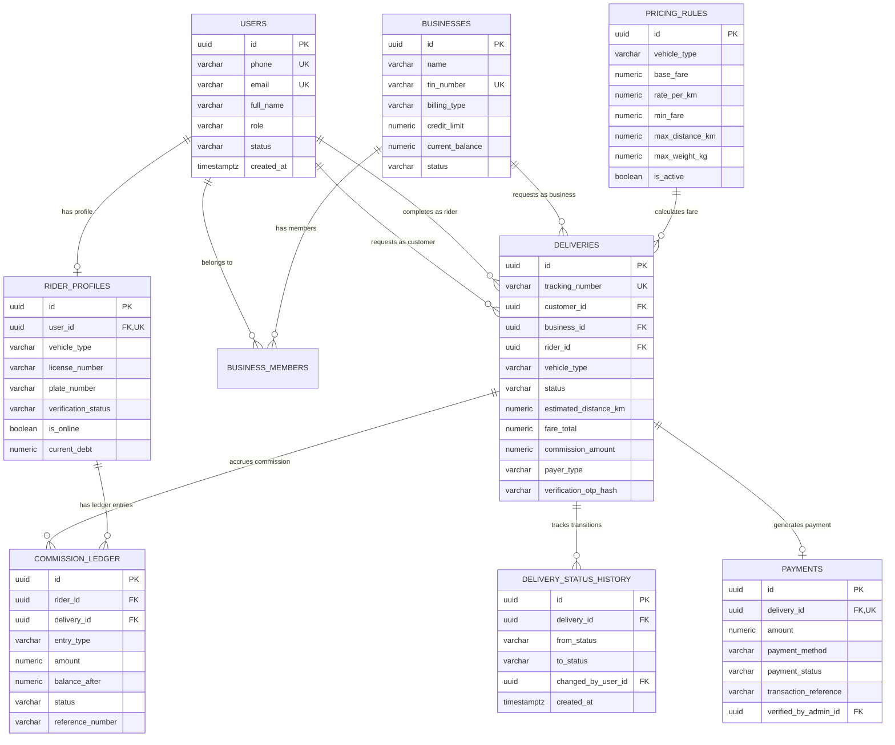

# Ethiopian Motorcycle & Bicycle Delivery Platform
## Database Design Specification (`DATABASE_DESIGN.md`)

---

## 1. Database Architecture & Technology

The primary database is **PostgreSQL on Neon**, accessed through **Drizzle ORM** in a serverless environment via connection pooling (PgBouncer).

### Key Architectural Standards
1. **Primary Keys**: Universally unique identifiers (`UUIDv7` or `gen_random_uuid()`) for all relational entities to avoid enumeration attacks and simplify distributed data creation.
2. **Monetary Precision**: All monetary values (fares, commissions, debts, settlements) are strictly typed as `NUMERIC(12, 2)`. Floating-point types (`FLOAT`, `REAL`, `DOUBLE PRECISION`) are prohibited.
3. **Geographic Coordinates**: Stored as `NUMERIC(9, 6)` for latitude and longitude, providing accuracy down to ~11 centimeters, which is ideal for pickup/drop-off pins without requiring heavy external GIS extensions.
4. **Time & Auditing**: Every table includes `created_at TIMESTAMPTZ DEFAULT NOW()` and `updated_at TIMESTAMPTZ DEFAULT NOW()`. Timestamps are always stored in UTC.

---

## 2. Entity-Relationship (ER) Diagram



---

## 3. Table Schema Definitions

### 3.1 `users` Table
Stores authentication identity and platform roles.

| Column | Data Type | Constraints | Description |
| :--- | :--- | :--- | :--- |
| `id` | `UUID` | Primary Key, `DEFAULT gen_random_uuid()` | Unique user identifier |
| `phone` | `VARCHAR(20)` | `NOT NULL`, `UNIQUE` | Ethiopian phone number (e.g., `+251911234567`) |
| `email` | `VARCHAR(255)` | `UNIQUE`, `NULLABLE` | Optional for customers/riders, used by business accounts |
| `password_hash` | `VARCHAR(255)` | `NULLABLE` | Used for email/password logins (business/admin) |
| `full_name` | `VARCHAR(100)` | `NOT NULL` | Legal full name |
| `role` | `VARCHAR(20)` | `NOT NULL` | Enum: `customer`, `rider`, `business_staff`, `admin` |
| `status` | `VARCHAR(20)` | `NOT NULL`, `DEFAULT 'active'` | Enum: `active`, `suspended`, `pending_verification` |
| `created_at` | `TIMESTAMPTZ` | `NOT NULL`, `DEFAULT NOW()` | Account creation time |
| `updated_at` | `TIMESTAMPTZ` | `NOT NULL`, `DEFAULT NOW()` | Last update timestamp |

### 3.2 `businesses` Table
Stores corporate merchant and business accounts.

| Column | Data Type | Constraints | Description |
| :--- | :--- | :--- | :--- |
| `id` | `UUID` | Primary Key, `DEFAULT gen_random_uuid()` | Unique business identifier |
| `name` | `VARCHAR(150)` | `NOT NULL` | Registered trading name |
| `tin_number` | `VARCHAR(50)` | `NOT NULL`, `UNIQUE` | Ethiopian Tax Identification Number |
| `contact_phone` | `VARCHAR(20)` | `NOT NULL` | Official business phone |
| `contact_email` | `VARCHAR(255)` | `NOT NULL` | Billing/notification email |
| `billing_type` | `VARCHAR(20)` | `NOT NULL`, `DEFAULT 'prepaid'` | Enum: `prepaid`, `postpaid_credit` |
| `credit_limit` | `NUMERIC(12, 2)` | `NOT NULL`, `DEFAULT 0.00` | Approved postpaid credit limit in ETB |
| `current_balance` | `NUMERIC(12, 2)` | `NOT NULL`, `DEFAULT 0.00` | Unpaid accrued delivery balance in ETB |
| `status` | `VARCHAR(20)` | `NOT NULL`, `DEFAULT 'active'` | Enum: `active`, `suspended`, `closed` |
| `created_at` | `TIMESTAMPTZ` | `NOT NULL`, `DEFAULT NOW()` | Creation timestamp |
| `updated_at` | `TIMESTAMPTZ` | `NOT NULL`, `DEFAULT NOW()` | Last modification timestamp |

### 3.3 `business_members` Table
Associates authorized staff with a corporate business account.

| Column | Data Type | Constraints | Description |
| :--- | :--- | :--- | :--- |
| `id` | `UUID` | Primary Key, `DEFAULT gen_random_uuid()` | Membership identifier |
| `business_id` | `UUID` | `NOT NULL`, `REFERENCES businesses(id) ON DELETE CASCADE` | Associated business |
| `user_id` | `UUID` | `NOT NULL`, `REFERENCES users(id) ON DELETE CASCADE` | Associated user |
| `member_role` | `VARCHAR(20)` | `NOT NULL`, `DEFAULT 'staff'` | Enum: `owner`, `manager`, `staff` |
| `created_at` | `TIMESTAMPTZ` | `NOT NULL`, `DEFAULT NOW()` | Date added |

*Index: `UNIQUE(business_id, user_id)`*

### 3.4 `rider_profiles` Table
Stores verification, vehicle details, online status, and location for couriers.

| Column | Data Type | Constraints | Description |
| :--- | :--- | :--- | :--- |
| `id` | `UUID` | Primary Key, `DEFAULT gen_random_uuid()` | Profile identifier |
| `user_id` | `UUID` | `NOT NULL`, `UNIQUE`, `REFERENCES users(id) ON DELETE CASCADE` | Associated user |
| `vehicle_type` | `VARCHAR(20)` | `NOT NULL` | Enum: `motorcycle`, `bicycle` |
| `license_number` | `VARCHAR(50)` | `NULLABLE` | Driving license number (motorcycles) |
| `plate_number` | `VARCHAR(30)` | `NULLABLE` | Motorcycle vehicle registration plate |
| `id_card_url` | `TEXT` | `NOT NULL` | Kebele ID / National ID document image URL |
| `license_doc_url` | `TEXT` | `NULLABLE` | Driver license image URL (motorcycle) |
| `verification_status` | `VARCHAR(20)` | `NOT NULL`, `DEFAULT 'pending'` | Enum: `pending`, `approved`, `rejected`, `suspended` |
| `verified_at` | `TIMESTAMPTZ` | `NULLABLE` | Timestamp of admin approval |
| `verified_by_admin_id`| `UUID` | `NULLABLE`, `REFERENCES users(id)` | Reviewing admin |
| `is_online` | `BOOLEAN` | `NOT NULL`, `DEFAULT false` | Availability flag for job broadcasts |
| `last_known_lat` | `NUMERIC(9, 6)` | `NULLABLE` | Current latitude |
| `last_known_lng` | `NUMERIC(9, 6)` | `NULLABLE` | Current longitude |
| `last_location_at` | `TIMESTAMPTZ` | `NULLABLE` | Timestamp of last location update |
| `current_debt` | `NUMERIC(12, 2)` | `NOT NULL`, `DEFAULT 0.00` | Accrued unpaid commission owed to platform |
| `created_at` | `TIMESTAMPTZ` | `NOT NULL`, `DEFAULT NOW()` | Registration timestamp |
| `updated_at` | `TIMESTAMPTZ` | `NOT NULL`, `DEFAULT NOW()` | Last update timestamp |

### 3.5 `pricing_rules` Table
Stores vehicle pricing parameters configurable by administrators.

| Column | Data Type | Constraints | Description |
| :--- | :--- | :--- | :--- |
| `id` | `UUID` | Primary Key, `DEFAULT gen_random_uuid()` | Rule identifier |
| `vehicle_type` | `VARCHAR(20)` | `NOT NULL` | Enum: `motorcycle`, `bicycle` |
| `name` | `VARCHAR(100)` | `NOT NULL` | e.g., "Addis Standard Motorcycle 2026" |
| `base_fare` | `NUMERIC(12, 2)` | `NOT NULL` | Fixed starting charge (ETB) |
| `rate_per_km` | `NUMERIC(12, 2)` | `NOT NULL` | Distance rate per kilometer (ETB) |
| `min_fare` | `NUMERIC(12, 2)` | `NOT NULL` | Absolute minimum delivery charge (ETB) |
| `max_distance_km`| `NUMERIC(6, 2)` | `NOT NULL` | Max permitted trip distance (km) |
| `max_weight_kg` | `NUMERIC(6, 2)` | `NOT NULL` | Max package weight (kg) |
| `cancellation_fee`| `NUMERIC(12, 2)` | `NOT NULL` | Fee charged if cancelled post-arrival |
| `commission_pct` | `NUMERIC(5, 2)` | `NOT NULL`, `DEFAULT 15.00` | Platform commission rate (e.g., 15.00%) |
| `is_active` | `BOOLEAN` | `NOT NULL`, `DEFAULT true` | Only one active rule per vehicle type |
| `created_at` | `TIMESTAMPTZ` | `NOT NULL`, `DEFAULT NOW()` | Rule creation timestamp |
| `updated_at` | `TIMESTAMPTZ` | `NOT NULL`, `DEFAULT NOW()` | Last update timestamp |

### 3.6 `deliveries` Table
Core transactional entity representing delivery requests and orders.

| Column | Data Type | Constraints | Description |
| :--- | :--- | :--- | :--- |
| `id` | `UUID` | Primary Key, `DEFAULT gen_random_uuid()` | Delivery identifier |
| `tracking_number`| `VARCHAR(25)` | `NOT NULL`, `UNIQUE` | Human-friendly code (e.g. `ET-DEL-91823`) |
| `customer_id` | `UUID` | `NOT NULL`, `REFERENCES users(id)` | Order creator |
| `business_id` | `UUID` | `NULLABLE`, `REFERENCES businesses(id)` | Corporate account (if booked for a business) |
| `rider_id` | `UUID` | `NULLABLE`, `REFERENCES users(id)` | Assigned courier |
| `vehicle_type` | `VARCHAR(20)` | `NOT NULL` | Enum: `motorcycle`, `bicycle` |
| `status` | `VARCHAR(20)` | `NOT NULL`, `DEFAULT 'requested'` | State machine enum |
| `pickup_address` | `TEXT` | `NOT NULL` | Street / Area description |
| `pickup_landmark`| `TEXT` | `NOT NULL` | Known landmark for pickup |
| `pickup_subcity` | `VARCHAR(50)` | `NOT NULL` | e.g., Bole, Kirkos, Yeka |
| `pickup_woreda` | `VARCHAR(20)` | `NULLABLE` | Local district number |
| `pickup_lat` | `NUMERIC(9, 6)` | `NULLABLE` | Pickup latitude pin |
| `pickup_lng` | `NUMERIC(9, 6)` | `NULLABLE` | Pickup longitude pin |
| `pickup_contact_name`| `VARCHAR(100)`| `NOT NULL` | Sender contact person |
| `pickup_contact_phone`| `VARCHAR(20)`| `NOT NULL` | Sender contact phone |
| `dropoff_address`| `TEXT` | `NOT NULL` | Destination street / area description |
| `dropoff_landmark`| `TEXT` | `NOT NULL` | Known landmark for drop-off |
| `dropoff_subcity`| `VARCHAR(50)` | `NOT NULL` | Destination sub-city |
| `dropoff_woreda` | `VARCHAR(20)` | `NULLABLE` | Destination woreda |
| `dropoff_lat` | `NUMERIC(9, 6)` | `NULLABLE` | Drop-off latitude pin |
| `dropoff_lng` | `NUMERIC(9, 6)` | `NULLABLE` | Drop-off longitude pin |
| `dropoff_contact_name`| `VARCHAR(100)`| `NOT NULL` | Recipient contact person |
| `dropoff_contact_phone`| `VARCHAR(20)`| `NOT NULL` | Recipient contact phone |
| `package_description`| `TEXT` | `NOT NULL` | Brief contents description |
| `package_category`| `VARCHAR(50)` | `NOT NULL` | Document, Electronics, Clothes, etc. |
| `package_weight_kg`| `NUMERIC(6, 2)`| `NOT NULL` | Estimated parcel weight |
| `is_fragile` | `BOOLEAN` | `NOT NULL`, `DEFAULT false` | Handling requirement flag |
| `special_instructions`| `TEXT` | `NULLABLE` | Specific notes for courier |
| `estimated_distance_km`| `NUMERIC(6, 2)`| `NOT NULL` | Billed trip distance |
| `fare_base` | `NUMERIC(12, 2)`| `NOT NULL` | Base fare component (ETB) |
| `fare_distance` | `NUMERIC(12, 2)`| `NOT NULL` | Distance fare component (ETB) |
| `fare_surcharges`| `NUMERIC(12, 2)`| `NOT NULL`, `DEFAULT 0.00` | Surcharges (ETB) |
| `fare_total` | `NUMERIC(12, 2)`| `NOT NULL` | Final total delivery fee (ETB) |
| `commission_amount`| `NUMERIC(12, 2)`| `NOT NULL` | Platform commission due (ETB) |
| `payer_type` | `VARCHAR(20)` | `NOT NULL` | Enum: `sender`, `receiver`, `business_account` |
| `verification_otp_hash`| `VARCHAR(128)`| `NOT NULL` | Argon2/SHA-256 hash of 4-digit OTP |
| `verification_attempts`| `INT` | `NOT NULL`, `DEFAULT 0` | Failed OTP entry counter |
| `requested_at` | `TIMESTAMPTZ` | `NOT NULL`, `DEFAULT NOW()` | Broadcast timestamp |
| `assigned_at` | `TIMESTAMPTZ` | `NULLABLE` | Courier assignment timestamp |
| `arrived_pickup_at`| `TIMESTAMPTZ`| `NULLABLE` | Pickup arrival timestamp |
| `picked_up_at` | `TIMESTAMPTZ` | `NULLABLE` | Handover timestamp |
| `arrived_dropoff_at`| `TIMESTAMPTZ`| `NULLABLE` | Destination arrival timestamp |
| `delivered_at` | `TIMESTAMPTZ` | `NULLABLE` | Completed delivery timestamp |
| `cancelled_at` | `TIMESTAMPTZ` | `NULLABLE` | Cancellation timestamp |
| `created_at` | `TIMESTAMPTZ` | `NOT NULL`, `DEFAULT NOW()` | Record creation timestamp |
| `updated_at` | `TIMESTAMPTZ` | `NOT NULL`, `DEFAULT NOW()` | Record update timestamp |

### 3.7 `delivery_status_history` Table
Immutable chronological audit log of all delivery lifecycle state transitions.

| Column | Data Type | Constraints | Description |
| :--- | :--- | :--- | :--- |
| `id` | `UUID` | Primary Key, `DEFAULT gen_random_uuid()` | History record identifier |
| `delivery_id` | `UUID` | `NOT NULL`, `REFERENCES deliveries(id) ON DELETE CASCADE` | Associated delivery |
| `from_status` | `VARCHAR(20)` | `NULLABLE` | Previous state |
| `to_status` | `VARCHAR(20)` | `NOT NULL` | New state |
| `changed_by_user_id`| `UUID` | `NOT NULL`, `REFERENCES users(id)` | Actor triggering transition |
| `notes` | `TEXT` | `NULLABLE` | Optional explanation or reason |
| `lat` | `NUMERIC(9, 6)` | `NULLABLE` | GPS latitude at moment of transition |
| `lng` | `NUMERIC(9, 6)` | `NULLABLE` | GPS longitude at moment of transition |
| `created_at` | `TIMESTAMPTZ` | `NOT NULL`, `DEFAULT NOW()` | Transition timestamp |

### 3.8 `payments` Table
Captures direct customer-to-rider delivery fee collections and corporate billing charges.

| Column | Data Type | Constraints | Description |
| :--- | :--- | :--- | :--- |
| `id` | `UUID` | Primary Key, `DEFAULT gen_random_uuid()` | Payment record identifier |
| `delivery_id` | `UUID` | `NOT NULL`, `UNIQUE`, `REFERENCES deliveries(id)` | Associated delivery |
| `payer_user_id` | `UUID` | `NULLABLE`, `REFERENCES users(id)` | Payer account (if known) |
| `payee_rider_id`| `UUID` | `NOT NULL`, `REFERENCES users(id)` | Courier receiving the payment |
| `amount` | `NUMERIC(12, 2)`| `NOT NULL` | Total collected fee (ETB) |
| `payment_method`| `VARCHAR(20)` | `NOT NULL` | Enum: `cash`, `telebirr`, `cbe_birr`, `business_credit` |
| `payment_status`| `VARCHAR(30)` | `NOT NULL` | Enum: `pending`, `collected_unverified`, `verified`, `disputed` |
| `transaction_reference`| `VARCHAR(100)`| `NULLABLE` | Telebirr / CBE transaction SMS reference code |
| `proof_image_url`| `TEXT` | `NULLABLE` | Screenshot of SMS receipt |
| `verified_by_admin_id`| `UUID` | `NULLABLE`, `REFERENCES users(id)` | Admin verifying the reference |
| `verified_at` | `TIMESTAMPTZ` | `NULLABLE` | Verification timestamp |
| `notes` | `TEXT` | `NULLABLE` | Payment audit notes |
| `created_at` | `TIMESTAMPTZ` | `NOT NULL`, `DEFAULT NOW()` | Record creation timestamp |
| `updated_at` | `TIMESTAMPTZ` | `NOT NULL`, `DEFAULT NOW()` | Record update timestamp |

### 3.9 `commission_ledger` Table
Append-only double-entry financial ledger tracking platform fees owed by couriers and manual settlements.

| Column | Data Type | Constraints | Description |
| :--- | :--- | :--- | :--- |
| `id` | `UUID` | Primary Key, `DEFAULT gen_random_uuid()` | Ledger record identifier |
| `rider_id` | `UUID` | `NOT NULL`, `REFERENCES users(id)` | Courier account |
| `delivery_id` | `UUID` | `NULLABLE`, `REFERENCES deliveries(id)` | Associated delivery (if fee accrual) |
| `entry_type` | `VARCHAR(30)` | `NOT NULL` | Enum: `commission_accrual`, `settlement_payment`, `adjustment`, `penalty` |
| `amount` | `NUMERIC(12, 2)`| `NOT NULL` | Amount in ETB (positive = debt increased, negative = debt paid off) |
| `balance_after` | `NUMERIC(12, 2)`| `NOT NULL` | Snapshot of rider's total debt balance after this entry |
| `status` | `VARCHAR(20)` | `NOT NULL`, `DEFAULT 'accrued'` | Enum: `accrued`, `pending_verification`, `settled`, `voided` |
| `reference_number`| `VARCHAR(100)`| `NULLABLE` | Bank / Telebirr settlement reference |
| `settled_by_admin_id`| `UUID` | `NULLABLE`, `REFERENCES users(id)` | Approving administrator |
| `notes` | `TEXT` | `NULLABLE` | Settlement details or reason for adjustment |
| `created_at` | `TIMESTAMPTZ` | `NOT NULL`, `DEFAULT NOW()` | Ledger entry timestamp |

---

## 4. Concurrency & Integrity Control

### 4.1 Atomic Job Claiming (No Double-Assignment)
To prevent race conditions when multiple couriers tap "Accept" simultaneously, we utilize PostgreSQL's row-level locking:

```sql
BEGIN;

-- Lock the target row and ensure status is still 'requested'
SELECT id 
FROM deliveries 
WHERE id = :delivery_id 
  AND status = 'requested' 
  AND rider_id IS NULL
FOR UPDATE;

-- If row is locked successfully and exists:
UPDATE deliveries
SET status = 'assigned',
    rider_id = :claiming_rider_id,
    assigned_at = NOW(),
    updated_at = NOW()
WHERE id = :delivery_id;

-- Record the status transition audit log
INSERT INTO delivery_status_history (
    delivery_id, from_status, to_status, changed_by_user_id, notes
) VALUES (
    :delivery_id, 'requested', 'assigned', :claiming_rider_id, 'Job claimed by rider'
);

COMMIT;
```

If the `SELECT ... FOR UPDATE` yields no row (meaning another transaction acquired the lock first and mutated the status), the transaction immediately rolls back and returns a conflict error.

---

## 5. Performance Indexes & Constraints

```sql
-- Fast lookup of available deliveries on the Job Board
CREATE INDEX idx_deliveries_job_board 
ON deliveries (status, vehicle_type, requested_at DESC) 
WHERE status = 'requested';

-- Fast lookup of a user's active and historical orders
CREATE INDEX idx_deliveries_customer 
ON deliveries (customer_id, created_at DESC);

-- Fast lookup of a rider's assigned deliveries
CREATE INDEX idx_deliveries_rider 
ON deliveries (rider_id, status) 
WHERE rider_id IS NOT NULL;

-- Fast tracking code resolution
CREATE UNIQUE INDEX idx_deliveries_tracking_number 
ON deliveries (tracking_number);

-- Ledger balance calculation for rider
CREATE INDEX idx_commission_ledger_rider 
ON commission_ledger (rider_id, created_at DESC);

-- Active pricing lookup
CREATE INDEX idx_pricing_rules_active 
ON pricing_rules (vehicle_type, is_active) 
WHERE is_active = true;
```

---

## 6. Location Data Privacy & Retention Policy

1. **Transient Location Data**: Courier real-time GPS tracking coordinates are maintained primarily in ephemeral memory/client state and updated in `rider_profiles.last_known_lat/lng`.
2. **Permanent Trip Data**: Only the origin (`pickup_lat`, `pickup_lng`) and destination (`dropoff_lat`, `dropoff_lng`) coordinates and total billed distance are permanently retained for auditing and receipts.
3. **Status Checkpoints**: Transition coordinates in `delivery_status_history` are retained for 90 days for dispute resolution, then anonymized.
4. **Phone Privacy**: Recipient contact numbers are visible to couriers only during the delivery window (`assigned` through `arrived_dropoff`). After completion, phone numbers are masked in all rider-facing API views.

---

## 7. Database Migration Strategy

- **Tooling**: **Drizzle Kit** (`drizzle-kit generate` & `drizzle-kit migrate`).
- **Principles**:
  - All migrations are forward-only and version-controlled as SQL scripts under `drizzle/migrations/`.
  - Schema changes must be backward-compatible (expand-and-contract pattern) to prevent downtime.
  - Migrations are tested automatically against a Neon staging branch in CI before execution on production.
  - Direct manual DDL execution on production is strictly prohibited.
