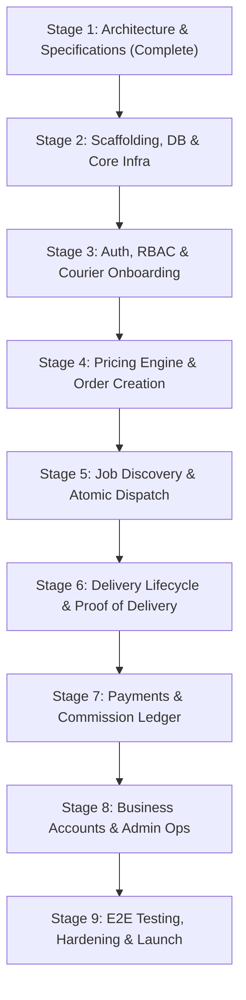

# Ethiopian Motorcycle & Bicycle Delivery Platform
## Development Roadmap (`DEVELOPMENT_ROADMAP.md`)

---

## 1. Roadmap Overview & Phased Execution

To ensure software quality, testability, and risk control, the project follows an iterative, stage-gated delivery roadmap. Each stage produces verifiable, testable deliverables that must pass strict acceptance gates before proceeding.

---

## 2. Stage Breakdown & Deliverables

### Stage 1: Specification & Technical Architecture (Current Stage)
- **Status**: Completed upon approval of documentation suite.
- **Deliverables**:
  - `docs/MVP_SPEC.md`
  - `docs/SYSTEM_ARCHITECTURE.md`
  - `docs/DATABASE_DESIGN.md`
  - `docs/DEVELOPMENT_ROADMAP.md`
  - `docs/AI_WORKING_RULES.md`
- **Acceptance Gate**: Documentation consistency verified; all architectural, schema, and business rules aligned; user sign-off achieved.

---

### Stage 2: Scaffolding, Core Infrastructure & Database Setup
- **Dependencies**: Stage 1 approval.
- **Goals**: Establish a robust, linted, type-safe full-stack Next.js project connected to Neon PostgreSQL.
- **Deliverables**:
  - Next.js 15+ App Router project initialized with TypeScript and Tailwind CSS.
  - Drizzle ORM configured with Neon serverless HTTP / WebSocket driver and PgBouncer pooler.
  - Database schema models implemented in `src/lib/db/schema.ts` matching `DATABASE_DESIGN.md`.
  - Baseline initial migration generated with `drizzle-kit generate`.
  - Vitest test runner and configuration configured and operational.
  - Base responsive layout, mobile viewport metadata, and Tailwind color system configured.
  - `.env.example` created with documentation of required variables.
- **Testing Requirements**:
  - Drizzle migration executes against a Neon development branch with zero errors.
  - Baseline unit test runs and passes cleanly via `npm run test`.
- **Exit Criteria**: Developer environment boots cleanly with `npm run dev`, database schema is deployed, and test suite executes.

---

### Stage 3: Authentication, RBAC & Courier Onboarding
- **Dependencies**: Stage 2.
- **Goals**: Implement phone-based identity, session management, and courier document verification.
- **Deliverables**:
  - Phone OTP authentication module (supporting Ethiopian `+251` mobile format with development OTP bypass for automated testing).
  - Secure HTTP-only session cookie management and authentication middleware.
  - Role-Based Access Control (RBAC) helpers (`requireRole()`, `requireRider()`, `requireAdmin()`).
  - Courier registration flow capturing vehicle type (`motorcycle` vs `bicycle`), ID card, and driver's license/plate.
  - Admin courier vetting dashboard to inspect documents and approve/reject/suspend couriers.
- **Testing Requirements**:
  - Unit tests for phone validation, OTP generation, and hashing.
  - Integration tests verifying unverified couriers cannot access rider-only endpoints.
  - Admin approval flow test verifying status updates to `approved`.
- **Exit Criteria**: Users can register and sign in; riders can upload documents; admins can review and approve riders.

---

### Stage 4: Pricing Engine & Delivery Request Creation
- **Dependencies**: Stage 3.
- **Goals**: Deliver accurate fare calculations and an intuitive, mobile-friendly order creation experience.
- **Deliverables**:
  - Configurable pricing rules engine (`pricing_rules` lookup with fallback defaults).
  - Fare calculation service handling base fare, distance rates, vehicle multipliers, minimum fares, and bicycle weight/radius restrictions.
  - Hybrid Ethiopian address selector (Sub-City dropdown, Woreda, Landmark input, and optional map pin drop).
  - Delivery booking form with Zod schema validation and React Hook Form.
  - Real-time upfront fare breakdown display.
  - Payer selection (`sender`, `receiver`, or `business_account`).
  - Delivery record insertion in `requested` status with cryptographically secure 4-digit OTP generation.
- **Testing Requirements**:
  - Unit tests verifying fare calculation across boundary conditions (minimum fare clamp, maximum bicycle distance rejection, vehicle surcharge).
  - Integration test verifying order creation persists correct monetary values in `NUMERIC(12, 2)` format without precision loss.
- **Exit Criteria**: A customer can configure and submit a valid delivery request, receive a tracking number, and view order summary.

---

### Stage 5: Job Discovery, Concurrency Control & Dispatch
- **Dependencies**: Stage 4.
- **Goals**: Allow couriers to view available jobs and claim them with zero risk of duplicate assignments.
- **Deliverables**:
  - Courier Job Board view listing available `requested` deliveries filtered by the courier's verified vehicle type.
  - Atomic job claim action using PostgreSQL transaction with `SELECT ... FOR UPDATE` row locking.
  - Conflict-handling UI displaying clear feedback if another courier claims the order first.
  - Real-time updates via Server-Sent Events (SSE) or adaptive polling for instant job list synchronization.
- **Testing Requirements**:
  - Concurrency integration test: Simulate two simultaneous claim requests for the exact same delivery ID within the same millisecond; assert exactly 1 succeeds and 1 fails with 409 Conflict.
  - Vehicle filter test: Assert bicycle couriers do not receive motorcycle-only orders.
- **Exit Criteria**: Couriers can discover and claim orders; concurrent claims are safely resolved.

---

### Stage 6: Delivery Execution & Proof of Delivery (PoD)
- **Dependencies**: Stage 5.
- **Goals**: Guide courier through pickup and transit, enforcing secure OTP verification upon delivery.
- **Deliverables**:
  - Courier active delivery screen with step-by-step actions:
    - `ARRIVED_PICKUP`
    - `PICKED_UP`
    - `ARRIVED_DROPOFF`
    - `DELIVERED`
  - Real-time customer delivery tracking view with status timeline and driver info.
  - Recipient 4-digit OTP verification modal at drop-off.
  - Failed/cancelled delivery workflow (recipient unreachable, sender cancel) with reason logging.
  - Audit logging of every state change in `delivery_status_history`.
- **Testing Requirements**:
  - State machine unit test: Assert invalid state jumps (e.g., `requested` directly to `delivered`) are blocked.
  - OTP verification test: Assert invalid OTP attempts increment the failure counter and block completion; assert valid OTP completes the order.
- **Exit Criteria**: A full delivery cycle can be progressed from assignment to completion with verified OTP.

---

### Stage 7: Payments, Commission Ledger & Manual Settlement
- **Dependencies**: Stage 6.
- **Goals**: Record direct peer-to-peer payments, maintain an append-only platform commission ledger, and enforce courier debt limits.
- **Deliverables**:
  - Payment collection entry UI for courier:
    - `Cash` (courier confirmation)
    - `Telebirr P2P` (transaction SMS reference input)
    - `CBE Birr P2P` (transaction SMS reference input)
  - Automatic commission ledger debit creation upon order completion (`amount = fare * commission_rate`).
  - Courier earnings and ledger balance dashboard showing accrued debt and payment history.
  - Courier commission settlement submission form (uploading proof of payment to platform's account).
  - Admin commission settlement reconciliation portal (review reference, approve credit entry, offset rider debt).
  - Debt ceiling check: Prevent couriers exceeding debt threshold (e.g., 500.00 ETB) from claiming new cash jobs.
- **Testing Requirements**:
  - Financial ledger unit tests: Verify double-entry integrity and exact cent calculations.
  - Debt enforcement test: Verify courier with debt > threshold is blocked from claiming jobs.
  - Settlement workflow integration test: Submit payment -> Admin approves -> Debt decreases by settled amount.
- **Exit Criteria**: Ledger records 100% of commissions accurately; admin can reconcile settlements; debt ceiling restricts delinquent couriers.

---

### Stage 8: Business Accounts & Operations Portal
- **Dependencies**: Stage 7.
- **Goals**: Provide commercial merchants with multi-user tools and operational backoffice oversight.
- **Deliverables**:
  - Business merchant registration and onboarding (TIN, trade name).
  - Business staff management (invite dispatchers, assign roles).
  - Business bulk/quick delivery booking interface.
  - Postpaid corporate credit limit checks and balance billing tracking.
  - Administrative operations dashboard: global delivery map/feed, manual dispatcher reassignment, dispute resolution tools, and CSV audit report exports.
- **Testing Requirements**:
  - Authorization isolation test: Assert staff from Business A cannot view or access deliveries from Business B.
  - Business credit limit test: Assert orders are blocked if corporate balance exceeds credit limit.
- **Exit Criteria**: Businesses can manage staff and book deliveries; admins have complete platform oversight and export capabilities.

---

### Stage 9: End-to-End Integration, Resilience & Production Launch
- **Dependencies**: Stages 1 through 8.
- **Goals**: End-to-end automated testing, cellular network resilience testing, security hardening, and deployment.
- **Deliverables**:
  - Comprehensive Playwright E2E test suite covering the entire user journey:
    - Customer books $\rightarrow$ Rider discovers & claims $\rightarrow$ Rider executes $\rightarrow$ OTP verifies $\rightarrow$ Ledger accrues $\rightarrow$ Admin settles.
  - Mobile PWA configuration (web app manifest, icons, high-contrast theme, offline fallback banner).
  - Performance audit: Mobile Lighthouse score $\ge 90$ for performance, accessibility, and best practices.
  - Production deployment to Vercel connected to Neon production branch with environment variables and security headers configured.
- **Testing Requirements**:
  - 100% passing Playwright test suite in CI.
  - Security audit verifying zero API secrets exposed to client bundles.
- **Exit Criteria**: The platform is live, stable, secure, and ready for real-world pilot deliveries.

---

## 3. Milestone Summary & Dependencies Table

| Stage | Name | Target Duration | Dependencies | Exit Verification Gate |
| :---: | :--- | :---: | :--- | :--- |
| **S1** | Architecture & Specifications | Day 1 | None | Documents created & reviewed |
| **S2** | Scaffolding, DB & Core Infra | Days 2–3 | S1 | DB migration passes, Vitest green |
| **S3** | Auth, RBAC & Rider Onboarding | Days 4–5 | S2 | Phone auth & rider approval functional |
| **S4** | Pricing Engine & Order Creation | Days 6–7 | S3 | Fare calculator & booking validated |
| **S5** | Job Discovery & Atomic Dispatch | Days 8–9 | S4 | Concurrency claim test passes |
| **S6** | Delivery Lifecycle & Proof of Delivery | Days 10–11 | S5 | Full delivery cycle & OTP verified |
| **S7** | Payments & Commission Ledger | Days 12–13 | S6 | Ledger math verified, settlement active |
| **S8** | Business Accounts & Admin Ops | Days 14–15 | S7 | Corporate multi-user & admin tools active |
| **S9** | E2E Testing, Resilience & Launch | Days 16–17 | S8 | Playwright E2E passing, live deployment |
