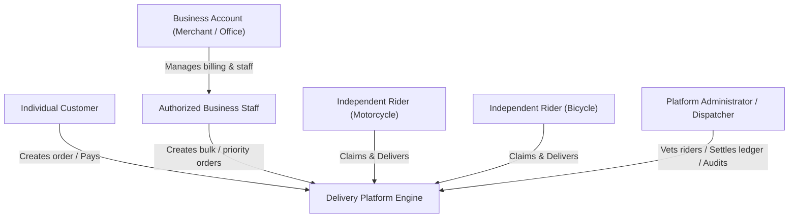
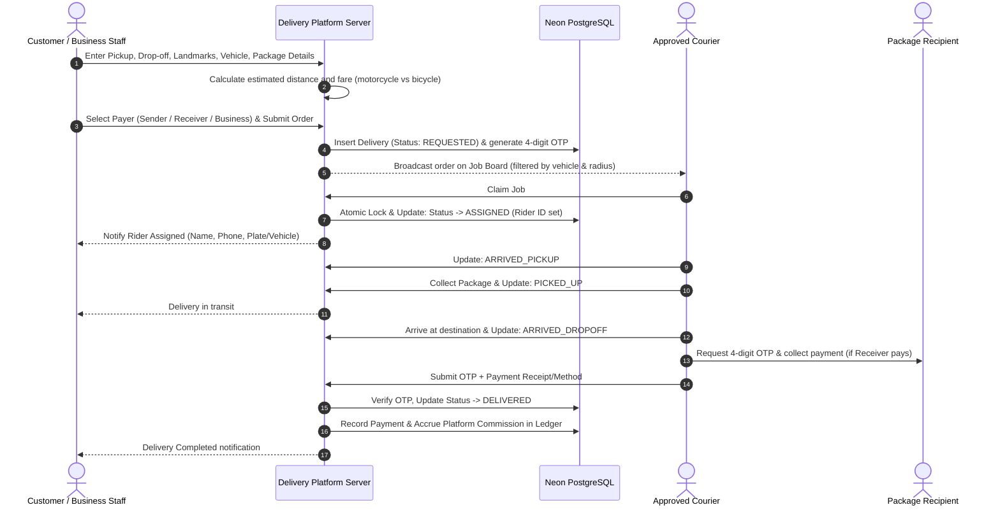
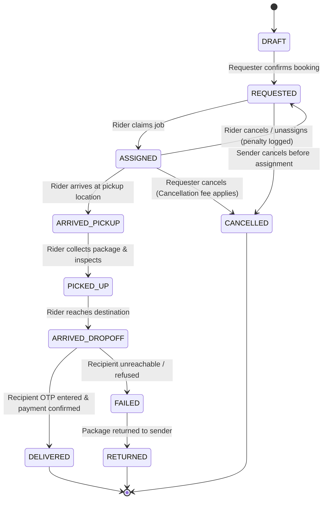

# Ethiopian Motorcycle & Bicycle Delivery Platform
## MVP Product Specification (`MVP_SPEC.md`)

---

## 1. Executive Summary & Product Goals

### 1.1 Vision
The platform is an urban logistics and on-demand courier system tailored specifically for the Ethiopian market, beginning with Addis Ababa and scalable to other major Ethiopian regional hubs (such as Hawassa, Adama, and Bahir Dar). The platform connects individual consumers and commercial enterprises with verified independent motorcycle and bicycle riders for rapid, predictable point-to-point parcel deliveries.

### 1.2 Core Product Goals
- **Urban Congestion Bypass**: Enable low-cost, fast deliveries across congested urban corridors using bicycles for short-range/lightweight parcels and motorcycles for medium-to-long citywide trips.
- **Reliable Localized Dispatch**: Address the unique addressing challenges in Ethiopia (landmark-centric navigation, lack of standardized house numbers) through combined GPS coordinates and descriptive landmark guidance.
- **Transparent, Fair Financial Engine**: Support local direct payment habits (Cash on Delivery of parcel service, Telebirr, and CBE Birr peer-to-peer transfers) without relying on unverified claims, while automating an accurate, tamper-proof platform commission ledger.
- **High Concurrency & Assignment Integrity**: Ensure zero duplicate assignments when multiple riders attempt to claim the same order simultaneously.
- **Mobile-First Accessibility**: Provide a responsive, lightweight web application optimized for low-bandwidth 3G/4G cellular connections, low data consumption, and intermittent connectivity.

---

## 2. Target User Personas & Roles



### 2.1 Individual Customers
- **Profile**: Urban residents sending personal items, gifts, documents, peer-to-peer sales items, or forgotten keys.
- **Key Needs**: Fast booking, upfront transparent price estimate, ability to select vehicle type (saving money with bicycles for nearby trips), simple payment via Cash, Telebirr, or CBE Birr, and clear status updates.

### 2.2 Business Accounts & Authorized Staff
- **Profile**: E-commerce vendors, boutique retailers, restaurants, pharmacies, legal/accounting offices, and administrative departments.
- **Hierarchy**:
  - **Business Owner/Admin**: Creates the business account, provides tax identification (TIN), manages staff members, selects billing method (per-delivery or monthly credit line subject to approval).
  - **Authorized Staff**: Can create, track, and cancel orders on behalf of the business without seeing organizational billing configurations or other branches' private orders.
- **Key Needs**: Multi-user access, recurring pickup addresses, downloadable delivery receipts, consolidated billing/invoicing.

### 2.3 Independent Couriers / Riders
- **Subgroups**:
  - **Bicycle Couriers**: Eco-friendly, hyper-local couriers operating within a 5–7 km radius. Ideal for lightweight packages, letters, documents, and small consumer items.
  - **Motorcycle Couriers**: Citywide couriers handling packages up to 25–30 kg across cross-town routes, steep topographies, and peripheral industrial or residential zones.
- **Key Needs**: Quick document submission for onboarding, transparent earnings and commission fees, fast job discovery board, one-tap atomic job claiming, simple route instructions with landmarks, and clear commission settlement.

### 2.4 Platform Administrators & Dispatchers
- **Profile**: Internal operational staff responsible for vetting couriers, resolving customer disputes, monitoring real-time exceptions (e.g., stuck deliveries, overdue claims), maintaining pricing rules, and auditing manual commission settlements.

---

## 3. MVP Scope vs. Future Exclusions

| Capability | In Scope for MVP | Excluded from MVP (Post-MVP Roadmap) |
| :--- | :--- | :--- |
| **Client Platforms** | Mobile-first Responsive Web App (PWA-ready) | Native iOS & Android apps (React Native / Flutter) |
| **Delivery Types** | Single pickup to single drop-off point-to-point | Multi-stop routes, round trips, pooled deliveries |
| **Package Types** | Parcels, documents, retail packages, gifts | Food delivery marketplace, hot food multi-vendor order |
| **Goods Purchasing** | **STRICTLY EXCLUDED**: Delivery fee only. Riders do NOT purchase goods on behalf of users. | Cash on Delivery (COD) for merchandise purchase |
| **Vehicle Types** | Motorcycle and Bicycle | Vans, trucks, or pedestrian walkers |
| **Pricing Model** | Rule-based (Base fare + Distance rate + Vehicle multiplier + Peak/Weather surcharge) | Machine-learning dynamic surge pricing |
| **Job Allocation** | Broadcast pool (available jobs listed to approved, eligible riders within radius with atomic claim) | Automated algorithmic batch dispatch |
| **Payments** | Direct payment to rider (Cash, Telebirr P2P, CBE Birr P2P) + manual commission ledger | Automated Telebirr/CBE Birr merchant API checkout debit |
| **Proof of Delivery** | 4-Digit Recipient OTP verification or verified recipient confirmation | In-app digital stylus signature capture, biometric scan |
| **Maps & Routing** | Leaflet / MapLibre with OpenStreetMap + landmark notes + OSRM distance estimation | Google Maps Premium paid API, turn-by-turn audio GPS |

---

## 4. End-to-End Delivery Workflow



### 4.1 Step-by-Step Breakdown

#### Step 1: Delivery Request Creation
- The requester specifies:
  - **Pickup Address**: Structured fields (City, Sub-City/Kifle Ketema, Woreda, Landmark/Prominent building, optional map pin lat/lng).
  - **Sender Information**: Name and Ethiopian mobile phone number (+251...).
  - **Destination Address**: Structured fields (City, Sub-City, Woreda, Landmark, optional map pin lat/lng).
  - **Recipient Information**: Name and Ethiopian mobile phone number (+251...).
  - **Package Specifications**: Category (Document, Electronics, Clothing, Fragile, Other), approximate weight, package dimensions/description, handling instructions.
  - **Vehicle Type**: Selection between `Motorcycle` and `Bicycle` (system automatically disables `Bicycle` if estimated distance exceeds bicycle range or package weight exceeds threshold).

#### Step 2: Fare Estimation & Payer Designation
- System computes distance using routing coordinates (or haversine distance with an urban street curvature factor of 1.35x when pin drops are used).
- System applies active pricing rules to display a line-item breakdown:
  - Base fare
  - Distance charge
  - Vehicle surcharge / discount
  - Minimum fare enforcement
- The requester designates the **Payer**:
  - `Sender`: Paid directly to rider at pickup point.
  - `Receiver`: Paid directly to rider at dropoff point.
  - `Business Account`: Charged to pre-authorized corporate billing balance (only available to registered business accounts).

#### Step 3: Job Broadcast & Atomic Claiming
- The order transitions to `REQUESTED`.
- Active, verified couriers matching the requested vehicle type discover the job on their available job feed.
- **Race Condition Prevention**: When a courier taps "Accept Job", the backend runs a transactional atomic update:
  ```sql
  UPDATE deliveries
  SET status = 'assigned', rider_id = $rider_id, updated_at = NOW()
  WHERE id = $delivery_id AND status = 'requested'
  RETURNING id;
  ```
  If zero rows are returned, the courier immediately receives an informative message that another rider already accepted the order.

#### Step 4: Package Pickup & Handover
- Courier navigates to the pickup landmark.
- Courier updates status to `ARRIVED_PICKUP`.
- Upon inspecting the parcel and verifying it matches the description, courier updates status to `PICKED_UP`.
- If the `Sender` is designated as the payer, the rider collects the delivery fee at this stage and records the payment method.

#### Step 5: Transit & Recipient Delivery Confirmation
- Courier travels to the drop-off location and updates status to `ARRIVED_DROPOFF`.
- **Proof of Delivery (OTP Handshake)**:
  - When the delivery was created, the platform generated a secure 4-digit numeric OTP.
  - The OTP is accessible to the sender and sent via SMS (or viewed in-app) to the recipient.
  - The courier asks the recipient for the OTP and enters it into the rider app.
  - The server verifies the OTP before allowing status transition to `DELIVERED`.
- If the `Receiver` is designated as the payer, the rider collects the delivery fee before handing over the parcel.

#### Step 6: Payment Recording & Commission Accrual
- Courier selects the payment instrument used:
  - `Cash`: Rider acknowledges receipt of physical cash.
  - `Telebirr P2P`: Rider records the transaction reference number provided by the payer's SMS receipt.
  - `CBE Birr P2P`: Rider records the transaction reference number from CBE Birr SMS.
- The platform creates an immutable ledger entry accruing platform commission (e.g., 15% of the delivery fee) as a payable debt against the rider's platform account.

---

## 5. Business, Pricing & Financial Rules

### 5.1 Strict Financial Guardrails
1. **No Goods Purchasing**: Couriers are strictly transport operators. The platform and couriers NEVER front money or purchase merchandise.
2. **Direct Payer-to-Rider Settlement**: Delivery fees are collected directly by the rider. The platform does not hold customer funds in escrow during MVP.
3. **No Unverified Payment Claims**:
   - An electronic payment (Telebirr / CBE Birr) reported by a rider or payer is flagged as `COLLECTED_UNVERIFIED` until administrative staff or automated statement reconciliation verifies the financial transaction reference.
   - Cash payments are recorded as `COLLECTED_CASH_RIDER_CONFIRMED`.
4. **Monetary Precision**: All monetary values are stored in `NUMERIC(12, 2)` (never floating point) in Ethiopian Birr (ETB).

### 5.2 Pricing Rules Model

The platform enforces a configurable pricing rules engine:

$$\text{Estimated Fare} = \max\Big(\text{MinFare}, \text{BaseFare} + (\text{DistanceKm} \times \text{RatePerKm}) + \text{Surcharges}\Big)$$

#### Initial Pricing Baseline (Configurable per Vehicle Type)
*Note: Values below are baseline defaults for testing and are fully configurable by administrators in the database without code redeployment.*

| Parameter | Bicycle Rule | Motorcycle Rule | Rationale |
| :--- | :--- | :--- | :--- |
| **Max Radius** | 7.0 km | 35.0 km | Physical endurance & battery/speed limits |
| **Max Weight** | 7.0 kg | 25.0 kg | Courier backpack capacity vs rear luggage rack |
| **Base Fare** | 50.00 ETB | 90.00 ETB | Low entry threshold for bicycle trips |
| **Per-Kilometer Rate** | 12.00 ETB / km | 22.00 ETB / km | Compensates for fuel and motorcycle maintenance |
| **Minimum Fare** | 60.00 ETB | 110.00 ETB | Guarantees minimum viable earnings per trip |
| **Cancellation Fee** | 25.00 ETB | 40.00 ETB | Compensates rider if sender cancels after arrival |

### 5.3 Commission Ledger Design
The platform tracks financial interactions with riders through an append-only ledger:
- **Accrual Entry**: When an order is completed, a ledger debit entry is created against the rider:
  - `Rider Balance = Previous Balance + Commission Amount`
- **Commission Threshold / Debt Ceiling**:
  - Every rider has an allowed maximum outstanding commission debt ceiling (e.g., 500.00 ETB).
  - If a rider's outstanding debt exceeds this ceiling, the platform blocks them from claiming new cash-settled deliveries until they settle their account.
- **Manual Settlement Workflow**:
  - The rider pays their accrued commission to the platform's official Telebirr or Commercial Bank of Ethiopia (CBE) business account.
  - The rider submits the payment reference / receipt in the courier portal.
  - A platform administrator inspects the company bank/Telebirr statement, verifies the reference, and approves the settlement in the admin dashboard.
  - Approval generates an offsetting credit ledger entry:
    - `Rider Balance = Previous Balance - Settled Amount`

---

## 6. Security, Identity & Operational Rules

### 6.1 Courier Verification Protocol
No courier can view or claim real deliveries until an administrator has reviewed their onboarding documents:
- **Identity Document**: Ethiopian Kebele ID card, National ID (Fayda), or Passport.
- **Motorcycle Specifics**: Valid driving license (Grade 1 / Auto/Motorcycle category), vehicle ownership book (Libre), and license plate number.
- **Bicycle Specifics**: National ID, current selfie photograph, and emergency contact.
- Status transitions: `PENDING_VERIFICATION` $\rightarrow$ `APPROVED` | `REJECTED` | `SUSPENDED`.

### 6.2 Delivery Status State Machine



### 6.3 State Transition Constraints
1. Only the assigned rider can advance statuses from `ASSIGNED` through `DELIVERED`.
2. Status cannot jump backwards (e.g., cannot move from `PICKED_UP` to `ASSIGNED`).
3. An order cannot be marked `DELIVERED` without valid OTP match or explicit admin emergency override.
4. If an order fails (e.g., recipient unreachable after 3 contact attempts), the rider must return the package to the pickup origin, triggering a return fee calculation.

---

## 7. Role-Based Access Control (RBAC) Matrix

| Resource / Action | Customer | Business Staff | Business Owner | Courier | Admin |
| :--- | :---: | :---: | :---: | :---: | :---: |
| Create Delivery Request | Yes | Yes | Yes | No | Yes (Phone Dispatch) |
| View Own Deliveries | Yes | Yes (Branch) | Yes (All) | Assigned Only | All |
| View Job Broadcast Pool | No | No | No | Verified Only | All |
| Claim Delivery Job | No | No | No | Verified Only | No |
| Advance Delivery Status | No | No | No | Assigned Only | Yes (Override) |
| Manage Business Staff | No | No | Yes | No | Yes |
| View Financial Commission Ledger | No | No | No | Own Ledger | All |
| Approve Courier Documents | No | No | No | No | Yes |
| Settle Commission Payment | No | No | No | Submit Proof | Verify & Settle |
| Modify Pricing Rules | No | No | No | No | Yes |
| View Platform Audit Logs | No | No | No | No | Yes |

---

## 8. Acceptance Criteria

### AC-1: Delivery Request & Fare Calculation
- Given a customer enters pickup and drop-off points with addresses and landmarks,
- When they select "Bicycle" and the distance is 4.5 km with a 3 kg package,
- Then the system calculates the fare accurately using bicycle pricing rules and displays the line-item breakdown.
- If the distance exceeds the configured maximum bicycle distance (7.0 km), the "Bicycle" option is disabled with a helpful explanation.

### AC-2: Atomic Job Claiming
- Given an active order in `REQUESTED` status,
- When two verified couriers simultaneously click "Accept Job" within milliseconds,
- Then exactly one courier is assigned the job (`ASSIGNED`), and the other receives a friendly message stating the job has already been claimed.

### AC-3: Proof of Delivery Verification
- Given a delivery in status `ARRIVED_DROPOFF`,
- When the courier submits an invalid OTP,
- Then the transition is rejected with an error message and the attempt count is logged.
- When the courier submits the correct 4-digit OTP,
- Then the delivery is marked `DELIVERED`, the completion timestamp is recorded, and the commission ledger entry is created.

### AC-4: Commission Ledger Integrity
- Given a completed delivery with a total fee of 150.00 ETB and a platform commission rate of 15%,
- When the delivery transitions to `DELIVERED`,
- Then an append-only ledger entry of exactly 22.50 ETB is debited to the courier's account, and their total outstanding balance updates accordingly.

### AC-5: Commission Debt Enforcement
- Given a courier whose total outstanding commission debt reaches or exceeds the configured limit (e.g. 500.00 ETB),
- When they attempt to view or claim new cash delivery jobs,
- Then the system prevents the action and prompts them to settle their outstanding balance.

---

## 9. Open Questions & Unresolved Decisions

The following items represent operational and regulatory questions requiring stakeholder decisions during or after MVP rollout:

| # | Topic | Question | Impact / Temporary MVP Assumption |
| :- | :--- | :--- | :--- |
| **Q1** | **Commission Rate** | Is the platform commission a flat percentage (e.g., 15%), a tiered percentage based on vehicle, or a flat fee per delivery? | **MVP Assumption**: Configurable percentage per vehicle type (default: 15% for motorcycle, 10% for bicycle). |
| **Q2** | **Debt Threshold** | What is the exact commission debt limit before a rider is suspended from taking new jobs? | **MVP Assumption**: Default set to 500.00 ETB; configurable in admin dashboard. |
| **Q3** | **Tax & Withholding** | Does the platform need to withhold 2% turnover tax (TOT) or 15% VAT on platform commission from riders? | **MVP Assumption**: Platform records pure gross commission ledger. Formal Ethiopian tax invoice exports deferred to Stage 8. |
| **Q4** | **Failed Delivery Fee** | Who pays for the return trip if the recipient is unreachable or refuses delivery? | **MVP Assumption**: Sender is liable for 100% original fare + 50% return fare. |
| **Q5** | **SMS Gateway Provider** | Which SMS provider will be used for Ethiopia (Ethiopian Telecom SMS Gateway, Africa's Talking, Twilio, or Gezachew/local aggregator)? | **MVP Assumption**: Generic SMS interface designed; in development/staging, OTP is logged to console and displayed in development UI helper. |
| **Q6** | **Package Value Limit** | What is the maximum declared parcel value permitted on motorcycle vs bicycle for liability/insurance purposes? | **MVP Assumption**: Maximum package value capped at 10,000 ETB for MVP; dangerous/illegal goods strictly prohibited by terms of service. |
