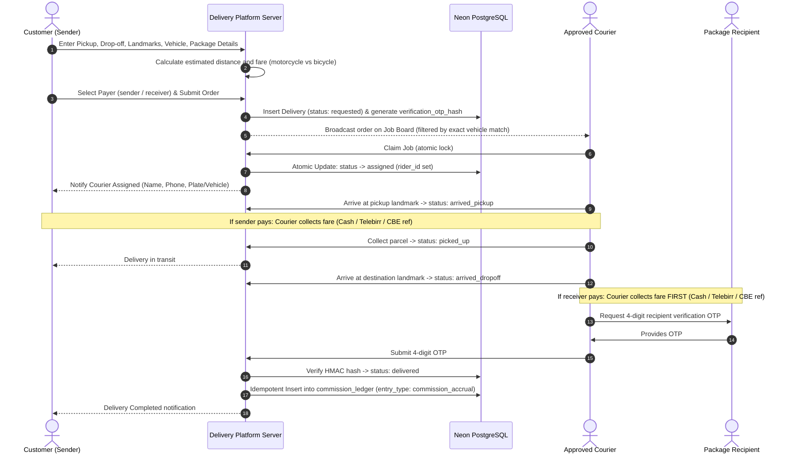
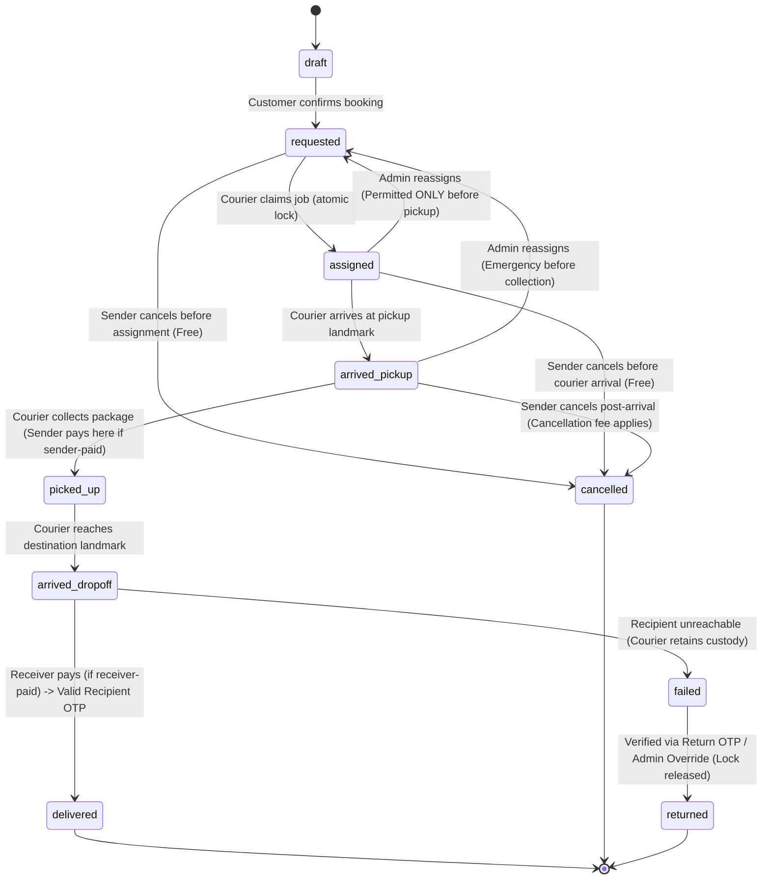

# Ethiopian Motorcycle & Bicycle Delivery Platform
## MVP Product Specification (`MVP_SPEC.md`)

---

## 1. Executive Summary & Product Goals

### 1.1 Vision
The platform is an urban logistics and on-demand courier system tailored specifically for the Ethiopian market. **The MVP pilot is strictly limited to Addis Ababa.** Expansion to other Ethiopian regional hubs (such as Hawassa, Adama, and Bahir Dar) is deferred to post-pilot evaluations. The platform connects individual consumers and commercial enterprises with verified independent motorcycle and bicycle couriers for rapid, predictable point-to-point parcel deliveries.

### 1.2 Core Product Goals
- **Urban Congestion Bypass**: Enable low-cost, fast deliveries across congested urban corridors using bicycles for short-range/lightweight parcels and motorcycles for medium-to-long citywide trips.
- **Reliable Localized Dispatch**: Address the unique addressing challenges in Addis Ababa (landmark-centric navigation, lack of standardized house numbers) through combined GPS coordinates, curated landmark matching, and descriptive landmark guidance.
- **Transparent, Fair Financial Engine**: Support local direct payment habits (Cash on delivery, Telebirr P2P, and CBE Birr P2P transfers) without relying on unverified claims, while automating an accurate, tamper-proof, append-only platform commission ledger.
- **High Concurrency & Assignment Integrity**: Ensure zero duplicate assignments when multiple couriers attempt to claim the same order simultaneously, while enforcing a single active delivery per courier.
- **Mobile-First Accessibility**: Provide a responsive, lightweight web application optimized for low-bandwidth 3G/4G cellular connections, low data consumption, and intermittent connectivity.
- **Detailed UX & Screen Flows**: Comprehensive screen-by-screen specifications and interaction states are detailed in [`docs/UX_CORE_SCREEN_FLOWS.md`](file:///e:/Personal/delivery%20app/Delivery_APP_system/docs/UX_CORE_SCREEN_FLOWS.md).

---

## 2. Target User Personas & Roles

```mermaid
graph TD
    PlatformAdmin["Platform Administrator / Dispatcher"]
    Customer["Individual Customer"]
    BusinessAccount["Business Account (Merchant / Office)"]
    BusinessStaff["Authorized Business Staff"]
    RiderMotorcycle["Independent Courier (Motorcycle)"]
    RiderBicycle["Independent Courier (Bicycle)"]

    Customer -->|Creates order / Pays directly| Platform[Delivery Platform Engine]
    BusinessAccount -->|Manages profile & staff| BusinessStaff
    BusinessStaff -->|Creates orders (Sender/Receiver pays)| Platform
    RiderMotorcycle -->|Claims & Delivers| Platform
    RiderBicycle -->|Claims & Delivers| Platform
    PlatformAdmin -->|Vets couriers / Reconciles settlements / Audits| Platform
```

### 2.1 Individual Customers
- **Profile**: Urban residents sending personal items, gifts, documents, peer-to-peer sales items, or forgotten keys.
- **Key Needs**: Fast booking, upfront transparent price estimate, ability to select vehicle type (saving money with bicycles for nearby trips), simple direct payment via Cash, Telebirr, or CBE Birr, and clear status updates.

### 2.2 Business Accounts & Authorized Staff
- **Profile**: E-commerce vendors, boutique retailers, restaurants, pharmacies, legal/accounting offices, and administrative departments.
- **MVP Billing Scope**: In the MVP, businesses can manage profiles, staff, and book deliveries, but **business-account centralized billing, prepaid credits, and monthly invoicing are deferred**. Every delivery fee is paid directly by the designated `sender` or `receiver`.
- **Key Needs**: Multi-user staff access, recurring pickup addresses, and downloadable delivery receipts.

### 2.3 Independent Couriers / Riders
- **Subgroups**:
  - **Bicycle Couriers**: Eco-friendly, hyper-local couriers operating within a 5–7 km radius. Ideal for lightweight packages, letters, documents, and small consumer items ($\le 5\text{ kg}$).
  - **Motorcycle Couriers**: Citywide couriers handling packages up to 25–30 kg across cross-town routes, steep topographies, and peripheral zones.
- **Key Needs**: Quick document submission for onboarding, transparent earnings and commission fees, fast job discovery board, one-tap atomic job claiming, landmark route instructions, and clear commission settlement.

### 2.4 Platform Administrators & Dispatchers
- **Profile**: Internal operational staff responsible for vetting couriers, resolving customer disputes, monitoring real-time exceptions (e.g., stuck deliveries, overdue claims), maintaining pricing rules, and auditing manual commission settlements.

---

## 3. MVP Scope vs. Future Exclusions

| Capability | In Scope for MVP | Excluded from MVP (Post-MVP Roadmap) |
| :--- | :--- | :--- |
| **Geographic Scope** | **Addis Ababa pilot only** | Regional expansion (Hawassa, Adama, Bahir Dar) |
| **Client Platforms** | Mobile-first Responsive Web App (PWA-ready) | Native iOS & Android apps (React Native / Flutter) |
| **Delivery Types** | Single pickup to single drop-off point-to-point | Multi-stop routes, round trips, pooled deliveries |
| **Package Types** | Parcels, documents, retail packages, gifts | Food delivery marketplace, hot food multi-vendor order |
| **Goods Purchasing** | **STRICTLY EXCLUDED**: Delivery fee only. Couriers do NOT purchase goods on behalf of users. | Cash on Delivery (COD) for merchandise purchase |
| **Vehicle Types** | Motorcycle and Bicycle (exact 1:1 matching baseline) | Vans, trucks, pedestrian walkers, cross-vehicle dispatch |
| **Payer Designation** | `sender` or `receiver` only (direct payment to courier) | Corporate billing, postpaid invoice lines, platform escrow |
| **Pricing Model** | Rule-based (Base fare + Distance rate + Vehicle multiplier) | Machine-learning dynamic surge pricing |
| **Job Allocation** | Broadcast pool (available jobs listed to approved, eligible couriers with atomic claim) | Automated algorithmic batch dispatch |
| **Payments** | Direct payment to courier (Cash, Telebirr P2P, CBE Birr P2P) + manual commission ledger | Automated Telebirr/CBE merchant API checkout gateway |
| **Proof of Delivery** | 4-Digit Recipient OTP verification at drop-off | In-app digital stylus signature capture, biometric scan |
| **Proof of Return** | 4-Digit Sender Return OTP or in-app sender confirm | Unverified courier return claims |
| **Maps & Routing** | Leaflet / MapLibre with OSM + landmark notes + centroid fallback | Paid Google Maps Premium API, audio turn-by-turn |

---

## 4. End-to-End Delivery Workflow



### 4.1 Step-by-Step Breakdown

#### Step 1: Delivery Request Creation
- The requester specifies:
  - **Pickup Address**: Structured fields (City: Addis Ababa, Sub-City, optional Woreda, Landmark/Prominent building, optional map pin lat/lng).
  - **Sender Information**: Name and Ethiopian mobile phone number (`+251[79]\d{8}`).
  - **Destination Address**: Structured fields (City: Addis Ababa, Sub-City, optional Woreda, Landmark, optional map pin lat/lng).
  - **Recipient Information**: Name and Ethiopian mobile phone number (`+251[79]\d{8}`).
  - **Package Specifications**: Category (Document, Electronics, Clothing, Fragile, Other), approximate weight, package description, handling instructions.
  - **Vehicle Type**: Selection between `motorcycle` and `bicycle` (system automatically disables `bicycle` if estimated distance exceeds 7.0 km or package weight exceeds 5.0 kg).

#### Step 2: Fare Estimation & Payer Designation
- System computes distance using verified coordinates or proposed Sub-City centroid defaults with a proposed $1.35\times$ urban street curvature factor.
- System applies active pricing rules to display a line-item breakdown (base fare, distance charge, minimum fare enforcement).
- If centroid fallback is used, the quote is flagged as an **Estimated Quote**, requiring customer acknowledgment prior to broadcast.
- The requester designates the **Payer**:
  - `sender`: Paid directly to courier at pickup location.
  - `receiver`: Paid directly to courier at drop-off location.

#### Step 3: Job Broadcast & Atomic Claiming
- The order transitions to `requested`.
- Active, verified couriers matching the requested vehicle type discover the job on their available job feed.
- **Concurrency & Single Active Job Guard**:
  - Because locking delivery rows alone cannot lock anything if the courier currently holds 0 active deliveries, the backend first acquires a **courier-level row lock on `rider_profiles`** (`SELECT ... FROM rider_profiles WHERE user_id = :claiming_rider_id FOR UPDATE`).
  - The transaction verifies:
    1. The courier currently holds **0 active deliveries** in `assigned`, `arrived_pickup`, `picked_up`, `arrived_dropoff`, or `failed` (backed at the database level by the partial unique index `idx_single_active_delivery_per_rider`).
    2. The courier's verified commission debt is strictly $< 500.00\text{ ETB}$.
    3. The delivery status is still `requested` and unassigned:
       ```sql
       UPDATE deliveries
       SET status = 'assigned', rider_id = :claiming_rider_id, assigned_at = NOW(), updated_at = NOW()
       WHERE id = :delivery_id AND status = 'requested' AND rider_id IS NULL
       RETURNING id;
       ```
  - If zero rows are returned, the transaction rolls back, and the courier receives an immediate notification that another courier claimed the job.

#### Step 4: Package Pickup & Handover
- Courier navigates to the pickup landmark.
- Courier updates status to `arrived_pickup`.
- **Cancellation Window**: Free cancellation applies while `requested` or `assigned` (pre-arrival). Once `arrived_pickup` is marked, customer cancellation incurs the vehicle-specific cancellation fee (25 ETB bicycle / 40 ETB motorcycle) payable directly to the courier with **0% platform commission**.
- *If `payer_type = 'sender'`*: The courier collects the delivery fee directly from the sender and logs the payment record.
- **Recipient OTP Generation**: When the courier inspects the parcel and advances status to `picked_up`:
  - The system generates or refreshes the 4-digit recipient verification OTP, salts and pepper-hashes it (HMAC-SHA256), and sets a 60-minute expiry window (`verification_otp_expires_at = NOW() + INTERVAL '60 minutes'`).
  - Prior to `picked_up`, all recipient OTP fields (`verification_otp_hash`, `verification_otp_salt`, `verification_otp_expires_at`) remain `NULL` in the database.
  - The OTP is dispatched via SMS/in-app notification to the recipient.
  - Ordinary customer cancellation is permanently disabled.

#### Step 5: Transit & Recipient Delivery Confirmation
- Courier travels to the drop-off location and updates status to `arrived_dropoff`.
- *If `payer_type = 'receiver'`*: The courier collects the delivery fee from the recipient **before physical handover** and logs the payment record (`collected_cash_rider_confirmed` or `collected_unverified`). Unverified electronic transfers (`collected_unverified`) unblock handover without waiting for backoffice reconciliation.
- **Proof of Delivery & Idempotent Commission Accrual**:
  - Courier asks recipient for the 4-digit recipient OTP and submits it.
  - The backend executes an atomic transaction that acquires a row-level lock on `rider_profiles` to serialize the courier's financial ledger balance.
  - The state transition from `arrived_dropoff` $\rightarrow$ `delivered` and the insertion of the `commission_accrual` debit into `commission_ledger` are atomically linked (via CTE).
  - The commission ledger insert occurs **if and only if** the delivery update succeeds and the recipient OTP is valid, unexpired, and unused.
  - Retries, network timeouts, or duplicate OTP submissions are safely handled without duplicate ledger debits (guaranteed by the unique index `idx_unique_delivery_commission`).

#### Step 6: Failed Delivery & Return Protocol
- If the recipient is unreachable after 3 documented calls over 10 minutes, or refuses the package, status moves to `failed`.
- The courier retains physical custody of the parcel and the single-active-delivery lock.
- **Return Handover**: The courier returns the parcel to the sender at the pickup origin. Handover is confirmed via a separate **4-digit Sender Return OTP**, sender in-app confirmation, or an Authorized Admin Return Override, transitioning the order to `returned` and releasing the courier's active lock.
- **Audit Persistence**: All return lifecycle transitions (including administrative overrides) are strictly recorded in `delivery_status_history` using `changed_by_user_id`, `created_at`, `notes`, `lat`, and `lng`. No non-existent columns (such as dedicated IP or user-agent fields) are claimed.
- **Zero Commission Accrual**: Deliveries ending in `failed` $\rightarrow$ `returned` bypass `delivered` and **never trigger commission accrual**.
- **Return Fare**: The original delivery fare remains due from the sender (`payment_type = 'return_fare'`). If payment is refused or disputed, it routes to Admin Dispute Resolution; zero commission is debited from the courier while the dispute is pending.

---

## 5. Business, Pricing & Financial Rules

### 5.1 Strict Financial Guardrails
1. **No Goods Purchasing**: Couriers are strictly transport operators. The platform and couriers NEVER front money or purchase merchandise.
2. **Direct Payer-to-Courier Settlement**: Delivery fees are collected directly by the courier. The platform does not hold customer funds in escrow during MVP.
3. **Payer Rules**: Only `sender` or `receiver` may be selected as payer during the MVP. Business-account centralized billing is deferred.
4. **No Unverified Payment Claims**:
   - Electronic payments (Telebirr / CBE Birr P2P) reported by a courier are recorded as `collected_unverified` until administrative staff reconcile the financial transaction reference.
   - Cash payments are recorded as `collected_cash_rider_confirmed`.
5. **Monetary Precision**: All monetary values are stored in `NUMERIC(12, 2)` (never floating point) in Ethiopian Birr (ETB).
6. **Segregated Payment Tracking & Database Uniqueness**:
   - Delivery fee collections, post-arrival cancellation fees, and return fares are tracked as separate payment records via `payment_type`:
     - `delivery_fare`: Ordinary trip fare; debits platform commission upon `delivered`. Guarded by `idx_payments_single_successful_delivery_fare`.
     - `cancellation_fee`: Post-arrival cancellation fee (25.00 ETB bicycle / 40.00 ETB motorcycle) owed by sender after courier arrival at pickup (`arrived_pickup`). **100% of this fee belongs to the courier with 0% platform commission** (never accrues commission debt). Guarded by `idx_payments_single_cancellation_fee`.
     - `return_fare`: Original delivery fare due from sender when delivery ends in `failed` $\rightarrow$ `returned`. Zero platform commission is debited from the courier while disputed. Guarded by `idx_payments_single_return_fare`.
   - Each payment type is guarded by a dedicated partial unique index enforcing at most one successful collection (`collected_cash_rider_confirmed`, `collected_unverified`, `verified`) per delivery. Disputed or refused records (`disputed`, `refused_uncollected`) do not satisfy the unique index filter, enabling auditable tracking of payment disputes without constraint collisions.

### 5.2 Pricing Rules Model

The platform enforces a configurable pricing rules engine:

$$\text{Estimated Fare} = \max\Big(\text{MinFare}, \text{BaseFare} + (\text{DistanceKm} \times \text{RatePerKm}) + \text{Surcharges}\Big)$$

#### Initial Pricing Baseline (Configurable per Vehicle Type, Addis Ababa Pilot)
*Note: Values below are baseline defaults for testing in Addis Ababa only and are configurable by administrators without code redeployment. Distance, package limits, fare values, and commission rates must be validated during the pilot.*

| Parameter | Bicycle Rule | Motorcycle Rule | Rationale |
| :--- | :--- | :--- | :--- |
| **Max Radius** | 7.0 km | Citywide (Addis Ababa) | Physical endurance vs motor capability |
| **Max Weight** | 5.0 kg | 30.0 kg | Courier backpack capacity vs rear luggage rack |
| **Base Fare** | 30.00 ETB | 50.00 ETB | Low entry threshold for bicycle trips |
| **Per-Kilometer Rate** | 8.00 ETB / km | 12.00 ETB / km | Compensates for fuel and motorcycle maintenance |
| **Minimum Fare** | 40.00 ETB | 60.00 ETB | Guarantees minimum viable earnings per trip |
| **Cancellation Fee** | 25.00 ETB | 40.00 ETB | Paid by sender post-arrival; 100% to courier; 0% commission |
| **Test Commission Rate** | 10.00% | 15.00% | Configurable test rates; snapshotted at booking |

### 5.3 Commission Ledger Design
The platform tracks financial interactions with couriers through an append-only ledger:
- **Accrual Entry**: When an order transitions to `delivered`, a single idempotent ledger debit entry is created against the courier:
  - `entry_type = 'commission_accrual'`
  - `Rider Debt Balance = Previous Balance + Commission Amount`
  - **Balance Serialization**: Courier balance updates are serialized via `rider_profiles` row locks to prevent race conditions during concurrent financial events.
- **Commission Threshold / Debt Ceiling**:
  - Every courier has an allowed maximum outstanding commission debt ceiling (`500.00 ETB`).
  - If a courier's verified debt reaches or exceeds this ceiling, the platform blocks them from claiming **any new delivery** across all payment methods. The ledger is the sole source of truth.
- **Manual Settlement Workflow**:
  - The courier pays accrued commission to the platform's official Telebirr or CBE business account.
  - The courier submits the settlement request reference in the courier portal.
  - **Integrity Rule**: Unverified settlement requests do **not** post ledger credits or reduce active debt.
  - A platform administrator inspects the company bank/Telebirr statement, verifies the reference, and approves the settlement in the admin dashboard.
  - Approval posts an idempotent credit ledger entry (`entry_type = 'settlement_payment'`) reducing debt balance.

---

## 6. Security, Identity & Operational Rules

### 6.1 Courier Verification Protocol
No courier can view or claim real deliveries until an administrator has reviewed their onboarding documents:
- **Identity Document**: Ethiopian Kebele ID card, National ID (Fayda), or Passport (`id_card_url`).
- **Motorcycle Specifics**: Valid driving license (`license_doc_url`), vehicle ownership book / Libre (`ownership_doc_url`), and license plate number (`plate_number`).
- **Emergency Contact**: Name and phone required for both motorcycle and bicycle couriers.
- Status transitions: `pending` $\rightarrow$ `approved` | `rejected` | `suspended`.

### 6.2 Delivery Status State Machine



### 6.3 State Transition Constraints
1. Only the assigned courier can advance statuses from `assigned` through `delivered`.
2. Status cannot jump backwards (e.g., cannot move from `picked_up` to `assigned`).
3. An order cannot be marked `delivered` without a valid, unexpired 4-digit recipient OTP or explicit admin emergency override.
4. An order cannot be marked `returned` without a valid 4-digit sender Return OTP, in-app sender receipt confirmation, or explicit Authorized Admin Return Override.
5. Admin reassignment back to the open job board is permitted **strictly before package pickup** (`assigned` or `arrived_pickup`). Reassignment after `picked_up` is prohibited.

---

## 7. Role-Based Access Control (RBAC) Matrix

| Resource / Action | Customer | Business Staff | Business Owner | Courier | Admin |
| :--- | :--- | :--- | :--- | :--- | :--- |
| Create Delivery Request | Yes | Yes | Yes | No | Yes (Phone Dispatch) |
| View Own Deliveries | Yes | Yes (Branch) | Yes (All) | Assigned Only | All |
| View Job Broadcast Pool | No | No | No | Verified Only | All |
| Claim Delivery Job | No | No | No | Verified Only | No |
| Advance Delivery Status | No | No | No | Assigned Only | Yes (Override) |
| View Financial Commission Ledger | No | No | No | Own Ledger | All |
| Approve Courier Documents | No | No | No | No | Yes |
| Settle Commission Payment | No | No | No | Submit Request | Verify & Credit |
| Modify Pricing Rules | No | No | No | No | Yes |
| View Platform Audit Logs | No | No | No | No | Yes |

---

## 8. Acceptance Criteria

### AC-1: Delivery Request & Fare Calculation
- Given a customer enters pickup and drop-off points with addresses and landmarks in Addis Ababa,
- When they select "Bicycle" and the distance is 4.5 km with a 3 kg package,
- Then the system calculates the fare accurately using bicycle pricing rules and displays the line-item breakdown.
- If the distance exceeds the maximum bicycle distance (7.0 km) or weight exceeds 5.0 kg, the "Bicycle" option is disabled with an explanatory badge.

### AC-2: Atomic Job Claiming & Concurrency Lock
- Given an active order in `requested` status,
- When two verified couriers simultaneously tap "Accept Job" within milliseconds,
- Then exactly one courier is assigned the job (`assigned`), and the other receives an alert that the job is already claimed.
- If a courier already holds an active delivery (`assigned` through `failed`), the system blocks them from claiming additional jobs.

### AC-3: Proof of Handover Verification & Idempotent Commission Accrual
- Given a receiver-paid delivery in status `arrived_dropoff`,
- When the courier attempts to verify handover before recording fare collection,
- Then the action is blocked until payment collection is recorded (`collected_cash_rider_confirmed` or `collected_unverified`).
- When the courier submits the correct 4-digit recipient OTP,
- Then the delivery is marked `delivered`, and exactly one idempotent commission debit entry is posted to `commission_ledger`. Duplicate submissions or retries do not create duplicate ledger debits.

### AC-4: Commission Debt Enforcement
- Given a courier whose total verified outstanding commission debt reaches or exceeds 500.00 ETB,
- When they attempt to claim any new delivery,
- Then the system prevents the action and prompts them to settle their outstanding balance.
- Submitting an unverified settlement reference does not unblock job claiming until an admin approves the settlement.

### AC-5: Return Handover & Dispute Shield
- Given a delivery in status `failed`,
- When the courier transports the parcel back to the pickup origin,
- Then the courier's active delivery lock remains active until the sender provides the Return OTP, confirms receipt in-app, or an admin executes an Authorized Return Override.
- Zero platform commission is debited from the courier for the failed/returned delivery.

---

## 9. Catalog of Confirmed Decisions vs. Deferred Items

### 9.1 Confirmed MVP Decisions (Approved)
- **Pilot Scope**: Addis Ababa only.
- **Payer Types**: `sender` or `receiver` only; business billing deferred.
- **Monetary Precision**: All currency values stored in `NUMERIC(12, 2)`.
- **Commission Rates**: Test baselines of 15.00% (motorcycle) and 10.00% (bicycle) snapshotted at booking.
- **Cancellation Fee**: 25 ETB (bicycle) / 40 ETB (motorcycle) post-arrival fee owed by sender; 100% to courier; 0% platform commission.
- **Return Handover**: Two-party verification (Return OTP) or audited admin override; zero commission debited while disputed.
- **Status Casing**: Canonical lowercase snake_case matching [`docs/DATABASE_DESIGN.md`](file:///e:/Personal/delivery%20app/Delivery_APP_system/docs/DATABASE_DESIGN.md).

### 9.2 Deferred & Optional Items
- **Dedicated Timestamps (`failed_at` & `returned_at`)**: Preserved strictly as an optional schema decision for Stage 2.
- **Circuity Multiplier ($1.35\times$)**: Calibration against Addis Ababa GPS data deferred to Stage 4.
- **Cross-Vehicle Dispatch**: Retained as exact 1:1 matching pending future review.
