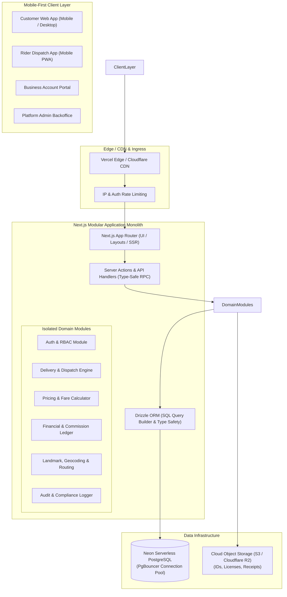
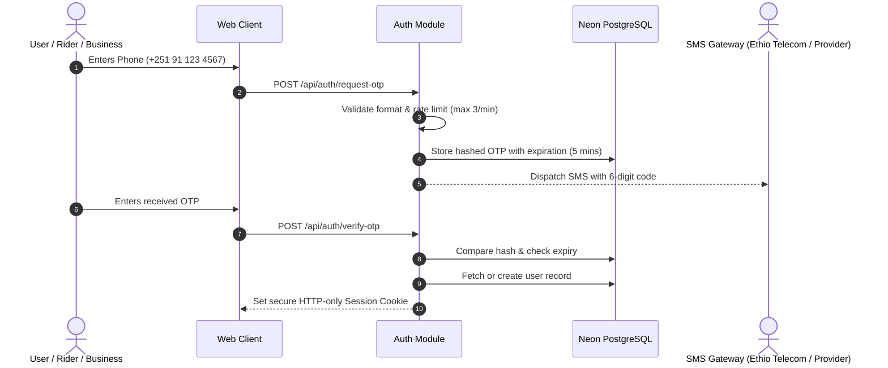
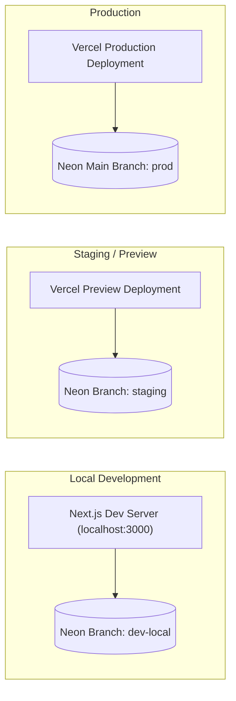

# Ethiopian Motorcycle & Bicycle Delivery Platform
## System Architecture (`SYSTEM_ARCHITECTURE.md`)

---

## 1. High-Level Architecture Overview

The system is designed as a **modular monolith** built on modern TypeScript, combining a high-performance Next.js full-stack application with a serverless PostgreSQL database on Neon. This architecture delivers low latency, zero cross-service network serialization overhead, full-stack type safety, and minimal infrastructure costs.



---

## 2. Technology Stack Evaluation & Recommendations

### 2.1 Proposed Stack Assessment

| Technology | Proposed Role | Assessment | Recommendation / Decision |
| :--- | :--- | :--- | :--- |
| **Next.js 15+ (App Router)** | Full-stack framework | Excellent fit. Unified TypeScript codebase for frontend and backend API. | **Adopt**. Use App Router with Server Components for low data consumption on mobile. |
| **TypeScript** | Language | Essential for robust financial and state-machine guarantees. | **Adopt strict mode** across entire project. |
| **Tailwind CSS** | Styling | Low bundle size, utility-first, rapid responsive design. | **Adopt**. Tailored for mobile-first views and high-contrast outdoor visibility for riders. |
| **Neon PostgreSQL** | Primary Database | Serverless PostgreSQL with instantaneous branching, built-in connection pooling (PgBouncer), and generous free tier. | **Adopt**. Matches staging/preview branch workflows perfectly. |
| **Drizzle ORM** | Data Access Layer | Recommended over Prisma due to zero cold-start latency, lightweight footprint, and direct SQL type safety. | **Adopt Drizzle ORM**. Critical for serverless environments. |
| **Zod** | Validation | Schema validation shared across client forms and server endpoints. | **Adopt**. Guarantees runtime data validation at every boundary. |
| **React Hook Form** | Form Management | Performant, uncontrolled inputs, zero unnecessary re-renders. | **Adopt** with `@hookform/resolvers/zod`. |
| **Vitest & Playwright** | Testing | Fast unit/integration tests (Vitest) and end-to-end browser automation (Playwright). | **Adopt**. Fast feedback loops with full browser coverage. |

---

## 3. Modular Monolith Architecture & Module Boundaries

To ensure maintainability without the operational overhead of microservices, the application is structured into decoupled domain modules under `src/modules/`:

```
src/
├── app/                        # Next.js App Router (Page views & layout wrappers)
│   ├── (auth)/                 # Login, Register, Verification
│   ├── (customer)/             # Customer order booking and tracking
│   ├── (rider)/                # Rider job board, active delivery, earnings
│   ├── (business)/             # Corporate dashboard, staff management, invoices
│   ├── (admin)/                # Admin review, disputes, pricing, commission ledger
│   └── api/                    # Route handlers (webhooks, SSE streams)
├── components/                 # Shared UI components (Button, Modal, Input, Badge)
├── lib/                        # Global utilities (database client, logger, errors)
└── modules/                    # Self-contained business domains
    ├── auth/                   # Sessions, OTP verification, RBAC guards
    ├── deliveries/             # Order creation, state transitions, atomic claiming
    ├── pricing/                # Configurable fare rules & calculation engine
    ├── ledger/                 # Double-entry commission tracking, settlements
    ├── riders/                 # Verification status, vehicle credentials, location
    ├── businesses/             # Business profiles, member access, credit limits
    ├── geo/                    # Addis Ababa landmarks, OSRM routing, distances
    └── audit/                  # Change tracking for compliance and dispute audit
```

### Module Boundary Rules
1. **No Circular Dependencies**: Lower-level modules (`geo`, `pricing`) never depend on higher-level modules (`deliveries`, `ledger`).
2. **Explicit Interfaces**: Modules communicate through explicit service functions (e.g., `pricingService.calculateFare()`), never by directly mutating another module's database tables.
3. **Database Ownership**: Each table has a primary owning module responsible for mutations.

---

## 4. Authentication, Identity & Authorization Strategy

### 4.1 Phone-First Authentication for the Ethiopian Market
- In Ethiopia, mobile numbers (`+251 9...` and `+251 7...` from Ethio Telecom and Safaricom Ethiopia) are the primary digital identity. Email is common only for corporate business accounts.
- **Authentication Flow**:
  1. User enters Ethiopian phone number.
  2. System generates a time-limited (5-minute) 6-digit cryptographic OTP.
  3. System sends OTP via SMS (or displays in development console during local dev/staging).
  4. User submits OTP; system validates and issues a secure, HTTP-only, SameSite session cookie.
- **Business Account Fallback**: Business administrators can also log in via Email + Password for desktop backoffice operations.



### 4.2 Authorization & Defense-in-Depth
- Authorization is strictly enforced on the server within Server Actions and Route Handlers. Client-side hiding of buttons is treated purely as UX, never security.
- Every protected operation verifies:
  1. Valid session signature.
  2. Active user status (`status = 'active'`).
  3. Required role or ownership permission (e.g., a rider can only update an order if `order.rider_id == session.user.id`).

---

## 5. Maps, Geocoding & Realtime Strategy for Ethiopia

### 5.1 Localized Mapping & Addressing
Commercial mapping solutions like Google Maps Platform impose high monthly costs and often suffer from sparse coverage of local alleys, sub-cities, and neighborhood landmarks in Ethiopian cities.

**Recommended Strategy**:
- **Display Layer**: **Leaflet** or **MapLibre GL JS** paired with **OpenStreetMap (OSM)** tiles. Open, fast, highly cached, and cost-free.
- **Geocoding & Addressing (Landmark-First Hybrid Model)**:
  - Ethiopian addressing is primarily landmark-based (e.g., *"Bole Sub-City, Woreda 03, behind Edna Mall, next to Kaldi's Coffee"*).
  - The UI uses a **hybrid address selector**:
    1. **Structured Text Inputs**: City, Sub-City (Kifle Ketema), Woreda, Landmark, and Door/Building details.
    2. **Interactive Map Pin Drop**: Optional coordinate pin for precise pickup/dropoff guidance.
- **Distance & Route Calculation**:
  - Primary: Free open routing engines like **OSRM (Open Source Routing Machine)** or Mapbox free tier.
  - Fallback: Great-Circle / Haversine distance with an urban street curvature circuity factor of **1.35x** to accurately account for winding urban routes and topography.

### 5.2 Realtime Updates on Intermittent Mobile Networks
Mobile internet connectivity in Ethiopia (3G/4G cellular) can experience brief drops, tower switching, and high latency. Heavy, persistent two-way WebSocket connections often disconnect, reconnect storm, and drain mobile battery rapidly.

**Recommended Strategy**:
- **Server-Sent Events (SSE)** for unidirectional real-time updates (e.g., Rider Job Board broadcasts, Customer live delivery progress). SSE automatically reconnects over standard HTTP/2 and operates efficiently behind proxies and cellular firewalls.
- **Adaptive Polling Fallback**: If SSE is unavailable or drops repeatedly, the client falls back to smart HTTP polling (e.g., polling every 8 seconds while delivery is in transit, with exponential backoff when idle).
- **Optimistic UI with Local Queueing**: Courier status updates (e.g., "Arrived at Pickup") are queued in the client if offline and synchronized immediately upon network recovery.

---

## 6. Deployment & Environment Strategy

### 6.1 Environment Topology



### 6.2 Database Branching with Neon
- Neon allows instant copy-on-write branching of the PostgreSQL database.
- Every staging release runs migrations against an isolated Neon staging branch containing sanitized production-like data, preventing any accidental disruption of production schemas.

### 6.3 Environment Configuration & Secrets Management
- All secrets (database connection strings, session encryption secrets, SMS API keys) reside in environment variables.
- Strictly prohibited: hardcoded secrets or committing `.env` files to source control.
- An `.env.example` file documents every required environment key with mock placeholders.

---

## 7. Security, Reliability & Performance Guardrails

### 7.1 Double-Assignment & Concurrency Protection
To prevent the catastrophic scenario where two riders simultaneously claim the same delivery job, the platform uses transactional atomic updates with PostgreSQL row-level locks:

```sql
-- Executed inside a single atomic database transaction
UPDATE deliveries
SET status = 'assigned',
    rider_id = :claiming_rider_id,
    assigned_at = NOW(),
    updated_at = NOW()
WHERE id = :delivery_id 
  AND status = 'requested'
  AND rider_id IS NULL
RETURNING id;
```
If the query returns zero rows, the job was already claimed or cancelled. The application immediately aborts the transaction and returns an HTTP 409 Conflict with a clear explanation to the second rider.

### 7.2 Financial Immutability & Ledger Accuracy
- **Zero Floating-Point Math**: All financial transactions, fares, fees, and commissions use `NUMERIC(12, 2)` in PostgreSQL and integer arithmetic / Big.js in TypeScript to eliminate IEEE-754 rounding errors.
- **Append-Only Ledger**: The commission ledger is write-only. Entries are never updated or deleted; adjustments require explicit credit/debit offsetting entries with an audit reference and administrator signature.

### 7.3 Data Privacy & Location Sanitization
- **Phone Number Privacy**: Recipient and sender phone numbers are exposed to the assigned courier only during an active delivery, and hidden once the status reaches `DELIVERED` or `CANCELLED`.
- **Location Pruning**: High-frequency GPS tracking points are ephemeral and discarded after 30 days. Only the static pickup and drop-off coordinates and total billed distance are permanently retained.

### 7.4 Cost Breakdown (Estimated Initial Monthly Cost)

| Service | Tier / Plan | Estimated Monthly Cost |
| :--- | :--- | :--- |
| **Hosting (Next.js)** | Vercel Hobby / Self-Hosted VPS | $0.00 - $20.00 |
| **Database (Neon PostgreSQL)** | Free Tier (0.5 GiB storage, shared compute) | $0.00 |
| **Maps & Routing** | OpenStreetMap / Leaflet / OSRM | $0.00 |
| **Object Storage (Files/IDs)** | Cloudflare R2 / AWS S3 (Free Tier 10GB) | $0.00 |
| **Total Estimated Operating Burn** | — | **< $20.00 / month** |
