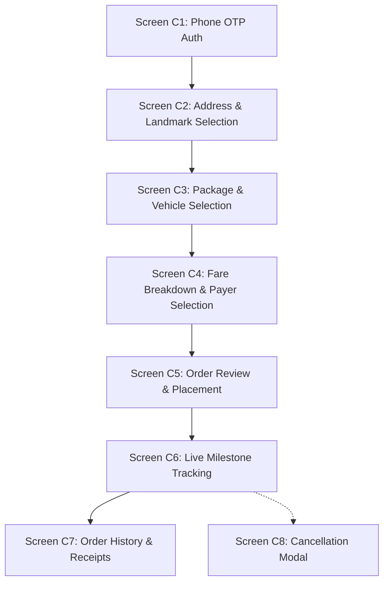
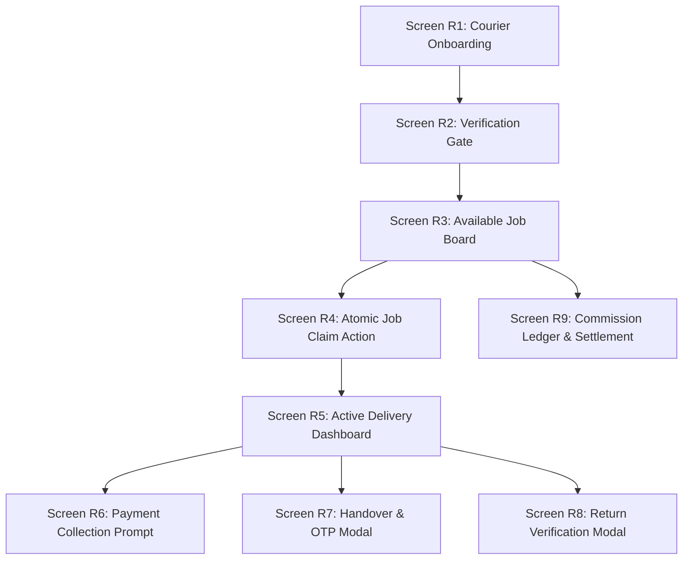
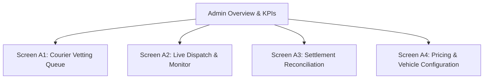

# Ethiopian Motorcycle & Bicycle Delivery Platform
## UX & Core Screen Flows Specification (`UX_CORE_SCREEN_FLOWS.md`)

---

## 1. Executive Summary & Purpose

This document defines the comprehensive user experience, screen-by-screen workflows, navigational state transitions, and validation rules for the Ethiopian Motorcycle and Bicycle Delivery Platform MVP. 

The initial pilot is strictly bounded to **Addis Ababa** and covers three primary interfaces:
1. **Customer Web App** (Mobile-first responsive web application for individual consumers and businesses).
2. **Rider Mobile PWA** (Progressive Web App for verified independent couriers).
3. **Platform Admin Portal** (Backoffice operations, dispatch oversight, courier vetting, and financial reconciliation).

All flows strictly align with the canonical database schema and operational state machines defined in [`docs/DATABASE_DESIGN.md`](file:///e:/Personal/delivery%20app/Delivery_APP_system/docs/DATABASE_DESIGN.md) and [`docs/MVP_SPEC.md`](file:///e:/Personal/delivery%20app/Delivery_APP_system/docs/MVP_SPEC.md).

---

## 2. Core Operational & Architectural Principles

### 2.1 Canonical Delivery Status Taxonomy
All UI screens, server actions, database records, and event logs strictly enforce the lowercase snake_case status enum:

| Status | Exact Definition | Permitted Actor |
| :--- | :--- | :--- |
| `draft` | Client-side booking form state before submission (not persisted in database). | Customer |
| `requested` | Delivery order submitted by customer; broadcast on open job board. | Customer / System |
| `assigned` | Delivery claimed atomically by a verified courier. | Courier |
| `arrived_pickup` | Courier reached the pickup landmark/location. | Courier |
| `picked_up` | Parcel physically collected and inspected; courier en route to destination. | Courier |
| `arrived_dropoff` | Courier reached destination landmark/location. | Courier |
| `delivered` | Recipient 4-digit OTP verified; physical handover complete. | Courier / System |
| `failed` | Recipient unreachable or refused delivery at drop-off destination. | Courier / Admin |
| `returned` | Undelivered parcel verified returned to sender at pickup origin. | Courier / Admin |
| `cancelled` | Order terminated prior to parcel pickup. | Customer / Admin |

> [!NOTE]
> `in_transit` is not a valid database status. The official persisted status while a courier carries an active parcel is `picked_up`.

---

### 2.2 Decoupled Handover, Payment, and Commission Accrual
Physical delivery custody, customer fee payment, statement verification, and platform commission accounting are decoupled:

1. **Recipient OTP Timing & Expiry**:
   - The 4-digit recipient verification OTP is **generated or refreshed at package collection (`picked_up`)**, not at initial order creation.
   - Prior to `picked_up`, all recipient OTP fields in `deliveries` (`verification_otp_hash`, `verification_otp_salt`, `verification_otp_expires_at`) are explicitly `NULL`.
   - The OTP has a strict **60-minute expiration window** from the moment `picked_up` is recorded.
2. **Delivery Completion (`deliveries.status = 'delivered'`)**:
   - Triggered **exclusively by 4-digit recipient OTP verification** confirming physical handover.
3. **Idempotent Commission Accrual & Serialized Ledger Balance**:
   - The successful transition to `delivered` is the **single trigger** for platform commission accrual.
   - The completion transaction executes a row lock on the courier's `rider_profiles` row to **serialize financial ledger updates**, preventing concurrent operations from computing corrupt `balance_after` values.
   - Posts exactly one debit entry (`entry_type = 'commission_accrual'`) to `commission_ledger`, guarded by the unique constraint `idx_unique_delivery_commission`.
4. **Receiver-Paid Deliveries Sequence**:
   - When `payer_type = 'receiver'`, fare collection must be recorded by the courier **before** physical handover and OTP verification.
   - For electronic transfers (Telebirr or CBE Birr P2P), the courier enters the payer's SMS transaction reference; the payment is recorded as `collected_unverified`.
   - `collected_unverified` immediately satisfies the payment step and unlocks the OTP entry modal. Downstream administrative verification (`verified`) is an accounting check that does not gate handover or commission accrual.
5. **Sender-Paid Deliveries Sequence**:
   - When `payer_type = 'sender'`, fare collection is recorded by the courier at the pickup location (`arrived_pickup` or `picked_up`).

---

### 2.3 Single Active Delivery Lock & Concurrency Guards
To prevent package hoarding, race conditions, and parcel abandonment:
- A courier may hold only **one active delivery** at any time across all non-terminal states: `assigned`, `arrived_pickup`, `picked_up`, `arrived_dropoff`, and `failed`.
- **Courier-Level Row Lock**: Because querying `deliveries` alone cannot lock anything when a courier has zero active jobs, the claim transaction locks the courier's row in `rider_profiles` (`SELECT ... FOR UPDATE`), serializing concurrent claim attempts by that courier.
- **Database-Level Guard**: The database enforces a partial unique index:
  ```sql
  CREATE UNIQUE INDEX idx_single_active_delivery_per_rider 
  ON deliveries (rider_id) 
  WHERE status IN ('assigned', 'arrived_pickup', 'picked_up', 'arrived_dropoff', 'failed');
  ```
- **The `failed` Guardrail**: If an order enters `failed` at drop-off, the courier remains actively assigned because they **retain physical custody of the parcel**. The courier is blocked from claiming any new delivery until the parcel is confirmed `returned` to the sender or resolved via authorized admin recovery.

---

### 2.4 Unconditional Debt Ceiling Rule
- If a courier's verified outstanding commission debt in `commission_ledger` is $\ge 500.00\text{ ETB}$, the courier is **strictly blocked from claiming any new delivery** across all payment methods.
- Submitting an unverified settlement reference creates a pending settlement audit request but **does not** post a ledger credit or reduce debt until admin verification.

---

### 2.5 Dedicated Cancellation-Fee Accounting
When an order is cancelled by the sender after the courier has reached `arrived_pickup`:
- **Liable Party**: The cancelling customer (sender) owes the fee (`25.00 ETB` for bicycle, `40.00 ETB` for motorcycle).
- **Courier Ownership**: **100% of the cancellation fee belongs to the courier** (0% platform commission). No commission debit is created in `commission_ledger`.
- **Dedicated Payment Record**: Logged as a distinct record (`payment_type = 'cancellation_fee'`) protected by partial unique index `idx_payments_single_cancellation_fee`:
  - `collected_cash_rider_confirmed`: Paid cash to courier at pickup.
  - `collected_unverified`: Transferred via Telebirr/CBE; SMS reference recorded.
  - `refused_uncollected`: Sender cancelled and refused to pay in person.
  - `disputed`: Sender disputes courier arrival or fee validity.
- Unpaid fees are flagged on the customer profile for administrative review; no automated wallet deductions or payment gateways are used.
- Ordinary customer cancellation is **disabled** once the parcel is `picked_up`.

---

### 2.6 Return Trip Fare, Dispute Protection & Safe Confirmation
1. **Return Fare Policy**:
   - When a delivery fails and the courier returns the parcel to origin (`returned`), the **original delivery fare remains due from the sender**.
   - No automatic return surcharge is generated by the system.
   - Recorded as a dedicated payment record (`payment_type = 'return_fare'`) protected by partial unique index `idx_payments_single_return_fare`.
2. **Zero Commission on Return / Disputes**:
   - Because `delivered` is never reached, a delivery ending in `failed` $\rightarrow$ `returned` **never triggers commission accrual**.
   - If the sender refuses payment or disputes the return, the incident routes to Admin Dispute Resolution. **Zero platform commission is debited from the courier** while the dispute is pending.
3. **Auditable Return Confirmation & Documented Storage**:
   - To transition from `failed` to `returned` and release the courier's active-job lock, one of two secure paths must occur:
     - **Sender Return OTP**: The sender provides a separate, secure 4-digit Return OTP (HMAC-SHA256 hashed, 60-minute expiry, max 5 attempts) generated when status moves to `failed`, OR taps *"Confirm Parcel Returned"* in their authenticated web app.
     - **Authorized Admin Return Override**: If the sender is hostile, unreachable, or has an unpowered phone, an administrator verifies the incident and executes a logged override.
   - **Audit Persistence Alignment**: All return confirmations strictly persist using the documented schema columns of `delivery_status_history`:
     - Actor: `changed_by_user_id` (sender `user_id` for in-app confirm, or admin `user_id` for override).
     - Timestamp: `created_at` (`NOW()`).
     - State transition: `from_status = 'failed'`, `to_status = 'returned'`.
     - Coordinates: `lat`, `lng`.
     - Operational Explanation: Captured in `notes` (documenting sender confirmation method, or admin override reason and support incident ticket reference). No unpersisted audit columns are assumed.

---

### 2.7 Landmark Addressing & Location Quote Distinction
- **Exact-Location Quote**:
  - Computed when coordinates are verified via the curated landmark dictionary or an interactive map pin drop.
- **Estimated Quote (Centroid Fallback)**:
  - Proposed fallback when a custom landmark cannot be resolved or GPS/map access is unavailable. Uses Sub-City administrative centroids with a proposed $1.35\times$ urban circuity factor.
  - The UI explicitly flags this as an **Estimated Quote**, requiring customer acknowledgment before order broadcast.
- **Navigational Grounding**: Descriptive landmark text and direct phone contact serve as the primary human routing mechanism for couriers.

---

### 2.8 Privacy & Data Safeguards
- **Public Tracking (`/track/[token]`)**: Exposes milestone status, courier first name, vehicle type, and sub-cities. Masks all personal phone numbers (`+251 91 ****56`) and completely hides financial data and identity documents.
- **Mutual Contact Expiry**: Customer and courier phone links are active only while the delivery is in progress (`assigned` through `arrived_dropoff` or `failed`). Links are deactivated once terminal (`delivered`, `returned`, `cancelled`).
- **Courier Documents**: National ID, Driver's License, and Libre ownership documents are stored in private buckets accessible strictly to authenticated administrators.
- **GPS Fallback**: If courier cellular signal drops or GPS is denied, the tracking view displays the **Last Verified Milestone Status** with sub-city progress badges rather than a frozen or misleading map pin.

---

### 2.9 Admin Reassignment Boundary
- Administrators may reassign an unresponsive courier and return the order to `requested` **only while status is `assigned` or `arrived_pickup`** (before parcel collection).
- After `picked_up`, reassignment back to the open job board is strictly prohibited since the courier physically holds the parcel.

---

## 3. Screen Flows: Customer Web App



### Screen C1: Phone Auth (Sign In / Sign Up)
- **Purpose**: Low-friction customer authentication using Ethiopian mobile numbers and 6-digit SMS OTP.
- **Fields**: Phone number (`+251[79]\d{8}`), Full Name (first-time sign up), 6-digit OTP code.
- **Validation**: Strict E.164 Ethiopian phone regex; rate limited to 3 OTP requests per 15 minutes; 60-second cooldown timer on resend.
- **States**: Loading spinner during SMS dispatch; error alerts for expired/incorrect codes; success sets HTTP-only session cookie and navigates to booking.

### Screen C2: Pickup & Drop-Off Address Selection
- **Purpose**: Structured address input tailored to Addis Ababa navigation.
- **Fields**:
  - `pickup_subcity` & `dropoff_subcity`: Dropdowns for 11 sub-cities (Bole, Kirkos, Arada, Yeka, Nifas Silk-Lafto, Lideta, Kolfe Keranio, Gulele, Akaki Kality, Addis Ketema, Lemi Kura).
  - `pickup_landmark` & `dropoff_landmark`: Mandatory descriptive text (3–150 characters, e.g., *"Opposite Edna Mall, behind Medhanialem Church"*).
  - `pickup_woreda` & `dropoff_woreda`: Optional district numbers.
  - Sender and recipient contact names and Ethiopian phone numbers.
  - Interactive map pin drop option for precise coordinate resolution.
- **Quote Mode Distinction**:
  - If coordinates are verified via map pin or landmark dictionary $\rightarrow$ **Exact Route Quote**.
  - If geocoding is unavailable or skipped $\rightarrow$ **Estimated Quote (Centroid Fallback)** with mandatory customer acknowledgment checkbox.

### Screen C3: Package Details & Vehicle Selection
- **Purpose**: Capture parcel dimensions and enforce vehicle operational constraints.
- **Fields**: Package category (Document, Clothing, Electronics, Fragile, Small Box, Other), estimated weight (kg), vehicle selection toggle (`bicycle` vs `motorcycle`).
- **Vehicle Guardrails**:
  - `bicycle` card is disabled with clear explanation if trip distance $>7\text{ km}$ or package weight $>5\text{ kg}$.
  - `motorcycle` card supports up to $30\text{ kg}$ and citywide distance.

### Screen C4: Fare Breakdown & Payer Selection
- **Purpose**: Present line-item price transparency and designate the paying party.
- **Fields**:
  - Payer toggle: `sender` (pays at pickup) vs `receiver` (pays at drop-off).
- **Line Items**: Base fare, distance fare, vehicle multiplier, and total ETB.
- **Customer Guidance Notice**:
  - If Sender: *"You will pay the courier [Total] ETB upon package pickup."*
  - If Receiver: *"The recipient will pay the courier [Total] ETB upon delivery."*

### Screen C5: Order Review & Confirmation
- **Purpose**: Final verification of addresses, landmarks, contacts, vehicle, payer, and total price before broadcast.
- **Primary Action**: `Confirm & Request Courier` $\rightarrow$ creates database record with status `requested` and navigates to Live Tracking.

### Screen C6: Live Milestone Tracking
- **Purpose**: Real-time progress monitor for the customer showing canonical status progression:
  1. `requested`: *"Searching for nearby couriers..."*
  2. `assigned`: *"Courier assigned: [First Name] ([Vehicle])"*. Call button activated.
  3. `arrived_pickup`: *"Courier arrived at pickup location."*
  4. `picked_up`: *"Package collected. Courier in transit to destination."* (Recipient OTP is generated at this milestone and dispatched to recipient).
  5. `arrived_dropoff`: *"Courier arrived at destination. Recipient handover in progress."*
  6. `delivered`: *"Delivery completed successfully."*
  7. `failed`: *"Delivery attempt unsuccessful. Courier holding package for return."*
  8. `returned`: *"Package returned to sender."*
  9. `cancelled`: *"Delivery cancelled."*
- **Primary Actions**:
  - `Call Courier`: Active only between `assigned` and `arrived_dropoff`.
  - `Share Public Tracking Link`: Generates tokenized URL masking sensitive phone numbers.
  - `Confirm Parcel Returned`: Appears if order is `failed` and courier returns parcel to origin.

### Screen C7: Order History & Receipts
- **Purpose**: Review past deliveries with tracking numbers, dates, sub-city routes, collected payments, and downloadable receipts.

### Screen C8: Cancellation Modal
- **Purpose**: Manage cancellation requests with clear fee transparency.
- **Rules & States**:
  - While `requested` or `assigned` (pre-arrival): *"Cancellation is free. Confirm cancellation?"*
  - While `arrived_pickup`: Warning: *"Courier has arrived at pickup. Cancelling now incurs a cancellation fee of [25.00/40.00] ETB payable directly to the courier. Confirm cancellation?"*
  - While `picked_up` or later: Cancellation button disabled. Explains: *"Package is in transit. Contact platform dispatch for emergencies."*

---

## 4. Screen Flows: Rider Mobile PWA (Courier Portal)



### Screen R1: Courier Registration & Document Submission
- **Purpose**: Onboard independent couriers with vehicle-specific compliance documents.
- **Fields**: Full name, mobile phone (`+251[79]\d{8}`), emergency contact name and phone, vehicle type (`motorcycle` | `bicycle`).
- **Required Uploads**:
  - Both: Kebele ID / National ID card photo (`id_card_url`).
  - Motorcycle Only: Driver's license photo (`license_doc_url`), license plate number, vehicle Libre ownership booklet photo (`ownership_doc_url`).
- **Result**: Sets `verification_status = 'pending'` and routes to Screen R2.

### Screen R2: Verification Gate
- **Purpose**: Guard screen informing applicant of vetting status (`pending`, `approved`, `rejected` with reasons, or `suspended`). Only `approved` couriers access the job board.

### Screen R3: Available Job Board Feed
- **Purpose**: Real-time broadcast feed of unassigned orders in `requested` status.
- **Job Card Elements**: Pickup/Drop-off Sub-Cities and landmarks, estimated distance (km), gross fare, net courier payout, vehicle badge, payer badge (`Sender Pays` | `Receiver Pays`).
- **Restrictions & Lockouts**:
  - Exact vehicle matching: Motorcycle couriers see motorcycle jobs; bicycle couriers see bicycle jobs.
  - Active Delivery Lock: Locked if courier has an active job in `assigned`, `arrived_pickup`, `picked_up`, `arrived_dropoff`, or `failed`.
  - Debt Ceiling Lock: Locked if accrued commission debt in `commission_ledger` is $\ge 500.00\text{ ETB}$.

### Screen R4: Job Claim Action
- **Purpose**: Atomically claim an open delivery.
- **Action**: Swipe to accept job.
- **Guardrails**: Server executes courier-level row lock on `rider_profiles`. If another courier claimed first or courier already holds an active delivery, transaction safely rolls back with clear feedback.

### Screen R5: Active Delivery Dashboard
- **Purpose**: Single-focus active execution dashboard guiding step-by-step progress.
- **Step Actions**:
  1. Status `assigned`: Displays pickup landmark and sender phone. Button: `Confirm Arrived at Pickup` $\rightarrow$ `arrived_pickup`.
  2. Status `arrived_pickup`:
     - *If Sender Pays*: Prompts fee collection (Screen R6).
     - Inspects package. Button: `Package Picked Up & Start Transit` $\rightarrow$ `picked_up`. (System generates 4-digit recipient OTP with 60-min expiry at this moment).
  3. Status `picked_up`: Displays destination landmark and recipient phone. Button: `Confirm Arrived at Drop-off` $\rightarrow$ `arrived_dropoff`.
  4. Status `arrived_dropoff`:
     - *If Receiver Pays*: Prompts fee collection (Screen R6) **before** unlocking handover.
     - Button: `Verify Handover (Enter Recipient OTP)` $\rightarrow$ opens Screen R7.
     - Button: `Report Handover Failure` (after 3 documented calls over 10 minutes) $\rightarrow$ updates status to `failed`.
  5. Status `failed`:
     - Explains: *"Handover failed. Return parcel to sender at pickup origin."*
     - Button: `Verify Parcel Returned to Sender` $\rightarrow$ opens Screen R8.

### Screen R6: Payment Collection Prompt
- **Purpose**: Record direct customer fee collection.
- **Timing**: At pickup if sender pays; at drop-off if receiver pays (prior to handover).
- **Fields**: Collected amount in ETB, payment method (`Cash` | `Telebirr P2P` | `CBE Birr P2P`), and transaction SMS reference code if electronic.
- **Status**: Saved as `collected_cash_rider_confirmed` or `collected_unverified`. Unverified electronic references immediately satisfy the step and allow handover.

### Screen R7: Recipient Handover Modal (4-Digit OTP)
- **Purpose**: Verify physical recipient package handover.
- **Fields**: 4-digit numeric recipient OTP.
- **Validation**: Validated against cryptographic HMAC hash; max 5 failed attempts before lockout.
- **Result**: Valid OTP updates status to `delivered`, records `delivered_at`, and triggers idempotent commission debit to `commission_ledger` with serialized courier balance updates.

### Screen R8: Return Verification Modal (4-Digit Return OTP)
- **Purpose**: Securely confirm that an undelivered parcel was returned to the sender.
- **Fields**: 4-digit Return OTP provided by the sender at pickup origin.
- **Validation**: Validated against independent `return_otp_hash`.
- **Result**: Valid OTP updates status to `returned`, releases the courier's active-job lock, and leaves the courier's ledger free of commission debits.

### Screen R9: Commission Ledger & Settlement Screen
- **Purpose**: Courier financial overview and settlement submission.
- **Displays**: Total completed orders, gross earnings, and verified outstanding commission debt from `commission_ledger`.
- **Action**: Courier transfers owed commission offline to platform Telebirr/CBE account and submits transaction reference. Creates pending settlement audit record (debt remains active until admin approval).

---

## 5. Screen Flows: Platform Admin Portal



### Screen A1: Courier Vetting Queue
- **Purpose**: Backoffice review and verification of courier applicants.
- **Features**: Data table filtering by status (`pending`, `approved`, `rejected`, `suspended`) and vehicle type.
- **Inspection Modal**: Secure viewer for Kebele ID, Driver's License, Vehicle Libre, and Plate number.
- **Actions**:
  - `Approve Courier`: Sets `verification_status = 'approved'`, unblocking job board.
  - `Reject Courier`: Requires mandatory rejection reason.
  - `Suspend Courier`: Disables courier dispatch access.

### Screen A2: Live Dispatch & Monitoring Console
- **Purpose**: Complete citywide visibility of all active and historical deliveries.
- **Features**: Filterable by all canonical statuses (`requested` through `cancelled`), sub-city, and vehicle type.
- **Administrative Actions**:
  - `Reassign Courier`: **Allowed strictly before pickup (`assigned` or `arrived_pickup`)**. Returns order to `requested`. Disabled after `picked_up`.
  - `Authorized Admin Return Override`: Resolves stuck `failed` deliveries where the sender cannot provide the Return OTP. Requires mandatory incident notes and reason logging in `delivery_status_history.notes`.
  - `Dispute Resolution Panel`: Resolves unpaid return fares and disputed cancellation fees.

### Screen A3: Commission Settlement Reconciliation
- **Purpose**: Audit courier debt payments against platform bank and Telebirr statements.
- **Reconciliation Queue**: Lists pending settlements: Courier Name, Claimed Amount, Method (`Telebirr` / `CBE`), Transaction Reference, and Timestamp.
- **Actions**:
  - Admin verifies transaction on platform's external bank/Telebirr portal.
  - `Approve Settlement`: Atomically posts `settlement_payment` credit entry to `commission_ledger`, recalculates debt balance, and unblocks courier if debt drops below 500 ETB.
  - `Reject Settlement`: Marks reference invalid; courier debt balance remains unchanged.

### Screen A4: Pricing & Vehicle Rule Configuration
- **Purpose**: Maintain active fare and operational parameters for Addis Ababa.
- **Configurable Parameters per Vehicle (`motorcycle` and `bicycle`)**:
  - Base Fare (ETB), Per-km Rate (ETB), Minimum Fare (ETB).
  - Cancellation Fee (ETB).
  - Commission Percentage (`commission_pct`).
  - Maximum trip distance (km) and maximum package weight (kg).
- **Audit**: All modifications log administrator ID, timestamp, and previous values.

---

## 6. Canonical State-Transition & Action Matrix

| Current Status | Target Status | Trigger Actor | Prerequisite / Concurrency Guard | Financial / Ledger Action |
| :--- | :--- | :--- | :--- | :--- |
| `draft` *(UI)* | `requested` | Customer | Valid Addis Ababa address, vehicle selected, quote acknowledged | Order created; no ledger entry |
| `requested` | `assigned` | Courier | Verified courier, 0 active jobs (`assigned`..`failed`), debt $<500\text{ ETB}$, exact vehicle match | Courier row lock acquired; index enforces single active job |
| `requested` | `cancelled` | Customer / Admin | Cancelled before courier assignment | Free cancellation (0.00 ETB) |
| `assigned` | `arrived_pickup` | Courier | Courier marks arrival at pickup landmark | None |
| `assigned` | `cancelled` | Customer / Admin | Cancelled before courier arrival at pickup | Free cancellation (0.00 ETB) |
| `assigned` | `requested` | Admin | **Courier reassignment permitted ONLY before pickup** | Order returns to board; rider unassigned |
| `arrived_pickup`| `cancelled` | Customer | Cancelled after courier arrival at pickup | **Cancellation fee (25/40 ETB) owed by sender; 100% to courier; 0% platform commission** |
| `arrived_pickup`| `requested` | Admin | Courier emergency before parcel collection | Order returns to board; rider unassigned |
| `arrived_pickup`| `picked_up` | Courier | Physical parcel collected. **(If sender pays, fare collection recorded here; recipient OTP generated here)** | None |
| `picked_up` | `arrived_dropoff`| Courier | Courier marks arrival at destination landmark | None |
| `arrived_dropoff`| `delivered` | Courier / System| **1. If receiver pays, fare collection recorded FIRST.**<br>**2. Valid 4-digit recipient OTP verified.** | **Single idempotent commission debit posted to `commission_ledger`; courier balance serialized** |
| `arrived_dropoff`| `failed` | Courier / Admin | Recipient unreachable/refused at drop-off. **Courier retains custody and active job lock.** | **NO commission accrual** (never reached `delivered`) |
| `failed` | `returned` | Courier / Admin | **Parcel verified returned via Return OTP, In-App Confirm, or Audited Admin Override.** | Courier active job lock released; original fare due from sender; zero commission debited while disputed |

---

## 7. Catalog of Confirmed Decisions vs. Deferred Items

### 7.1 Confirmed MVP Decisions (Approved)
- **Status Enum**: Canonical lowercase snake_case: `requested`, `assigned`, `arrived_pickup`, `picked_up`, `arrived_dropoff`, `delivered`, `failed`, `returned`, `cancelled`.
- **Recipient OTP Timing**: Generated/refreshed at `picked_up` with a 60-minute expiry window. Fields are `NULL` prior to collection.
- **Commission Trigger & Serialization**: Exactly once upon successful `delivered` transition; decoupled from payment submission. Ledger balance updates serialized per courier via row locks on `rider_profiles`. Deliveries ending in `failed` $\rightarrow$ `returned` bypass `delivered` and create zero commission debits.
- **Receiver Payment Sequence**: Fare collection recorded before recipient OTP handover; `collected_unverified` permitted for electronic transfers without delaying delivery.
- **Cancellation Fee Terms**: 25 ETB (bicycle) / 40 ETB (motorcycle) after `arrived_pickup` owed by sender; 100% to courier; 0% platform commission; separate collection record (`payment_type = 'cancellation_fee'`); no automatic deductions. Ordinary cancellation disabled at `picked_up`.
- **Return Fare & Dispute Protection**: Original delivery fare remains owed by the sender upon return (`payment_type = 'return_fare'`); non-payment is routed to admin dispute resolution; zero commission debited while disputed.
- **Return OTP Security & Audit Storage**: Independent secret from recipient delivery OTP, salted/peppered HMAC-SHA256 hashed storage, 60-min expiry, single use, 5-attempt lockout. Audit records persisted strictly in `delivery_status_history` using `changed_by_user_id`, `created_at`, `lat`, `lng`, and `notes`. Client IP addresses and user-agent strings are not stored as dedicated columns in `delivery_status_history` (any operational telemetry is recorded in server logs or within unstructured `notes`).
- **Debt Ceiling Rule**: Debt $\ge 500.00\text{ ETB}$ blocks courier from claiming any new delivery. Pending settlement requests do not reduce debt until admin approval.
- **Single Active Delivery**: Includes `failed` status until confirmed `returned` to sender or resolved via authorized admin override. Enforced via courier-level row lock and partial unique index `idx_single_active_delivery_per_rider`.
- **Admin Reassignment**: Permitted strictly before parcel collection (`assigned` or `arrived_pickup`).

### 7.2 Deferred & Optional Items
- **Dedicated Timestamps (`failed_at` & `returned_at`)**: Preserved strictly as an optional schema decision for Stage 2. (All lifecycle transitions remain fully audited via `delivery_status_history.created_at`).
- **Circuity Multiplier ($1.35\times$) & Centroid Calibration**: Tuning urban distance multipliers deferred to Stage 4 empirical GPS analysis.
- **Cross-Vehicle Dispatch**: Retained as exact 1:1 vehicle matching pending future business review.
